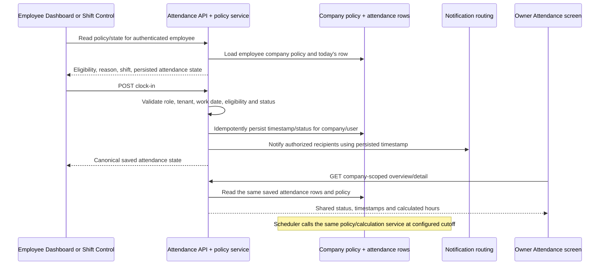

# SmartERP Attendance Implementation Plan

**Status:** Approved for implementation by the Owner on 2026-10-17. The proposed attendance defaults below are approved for this implementation. No production requests, production migrations, attendance edits, commit, push, or deployment are authorized by that approval.

**Evidence baseline:** `SMARTERP_COMPLETE_ATTENDANCE_SYSTEM_AUDIT.md` and a read-only recheck of the current frontend/backend paths on 2026-10-17. This plan treats source findings as verified only where directly visible in code; it does not claim production database/runtime verification.

## Goal

Repair the existing attendance workflow and make one backend-owned, company-scoped policy and attendance state drive the existing Owner and Employee screens. Keep the current screens and routes where possible; do not create a second attendance module or add a new portal tab. Preserve existing API response keys and meanings; any necessary response change must be additive or have a reviewed compatibility plan and regression coverage.

## 1. Owner Portal

| Existing screen/API | Planned change | Connection |
|---|---|---|
| `SmartERP-Frontend/app/owner/attendance/page.tsx` (`/owner/attendance`) and `GET /api/attendance/overview` | Keep the current roster and export. Display statuses from the shared backend classification; make late/half-day/checked-out distinctions consistent. Update summary definitions so check-in, absence, approved leave, and late counts are not conflated. Add a policy settings section/card on this existing screen (no new tab) for authorized Owner users. Refresh the roster after changes and on a safe refresh interval/focus. | Policy edits call the owner-only policy endpoint. The roster continues to use the same attendance records employees create; it must not infer status from browser time. |
| `SmartERP-Frontend/app/owner/attendance/[userId]/page.tsx` and `GET /api/attendance/employee/:userId`, `/calendar/:userId` | Keep monthly list/calendar and export-compatible fields. Display timezone-stable timestamps, automatic clock-out marker, and backend-calculated hours/status. Surface only already-supported correction/edit actions if product policy confirms them; the current UI is read-only although owner APIs exist. | Same persisted record and calculation helpers as employee state, clock-out processing, and reports. |
| Existing `/owner/settings` (`app/owner/settings/page.tsx`) and `/api/settings/company` | Current settings includes a timezone field and company settings JSON, but no attendance policy section was found. Prefer the Attendance screen as the policy control location to keep it with the existing attendance workflow. Reuse owner settings only if the owner approves that location. | Do not broaden the current generic company settings write to accept arbitrary attendance policy fields without dedicated validation and authorization. |

Owner summary and status definitions must be agreed before changing the counts. The audit found the current “Present” count means “has check-in,” “Absent” means “no check-in,” and there is no leave join in `/overview`. Do not count approved leave as absence without an agreed rule and a verified leave source.

## 2. Employee Portal

| Existing screen/component | Planned change | Connection |
|---|---|---|
| `/employee`, `SmartERP-Frontend/app/employee/page.tsx`, `components/clock-in-out.tsx` | Remove the widget’s independent 11:00 AM decision. Render eligibility, shift, status, and backend reason from the same policy/state response used by Shift Control. The widget should only show a successful punch after the server confirms persistence. Add request-in-progress/idempotent interaction handling. | Calls `/api/attendance/today` or a policy/state read, then `POST /api/attendance/clock-in` or `/clock-out`; server response updates shared client state. |
| `/employee/time-tracking`, `app/employee/time-tracking/page.tsx` | Use the same policy and eligibility response as Dashboard. Use the persisted server timestamps for the elapsed timer, refresh after visibility/focus and server-side automatic clock-out, and ensure offline queued punches are clearly pending. Do not replay an old offline timestamp as if it were the server punch time. | Reads `/today` and `/history`; uses the common clock endpoints. Its history must display the record returned by the backend and not a separate client classification. |
| `/employee/time`, `app/employee/time/page.tsx`, `components/smart-clock-in-out.tsx` | Keep the existing page, but remove the competing browser-side 7 PM clock-out or make it a deliberately one-shot presentation fallback only if a requirement is approved. It must use backend policy/timezone and cannot race the server scheduler. | The server scheduler is the authoritative auto clock-out. The page refreshes the same attendance state from `/me`/`today`. |
| Employee Dashboard/Time Tracking/history and `app/employee/reports/page.tsx` | Align display timezone, hours, and statuses; avoid independently deriving status from `Date.getHours()`. Refresh state after clock actions and after server-side changes (focus/refetch or an existing authorized event stream). | Owner and employee views remain projections of the same company-scoped attendance row. |

No new Employee attendance page is proposed. The offline workflow needs a decision on whether to support queued punches at all and, if supported, how to preserve actual punch time securely; the current queue stores client time but the replay request does not send it.

## 3. Shared backend and data flow

### Existing backend paths to centralize or correct

- `SmartERP-BackendEnd/routes/attendance.js`: existing `/clock-in`, `/clock-out`, `/me`, `/today`, `/history`, `/corrections`, `/overview`, `/employee/:userId`, `/calendar/:userId`, correction approval/rejection, `/:id`, `/report`, `/process-daily`, and `/biometric/webhook` routes.
- `SmartERP-BackendEnd/services/attendanceService.js`: currently a summary/query helper; extend or replace duplicated rule calculations only after confirming its callers and keeping a single rule owner.
- Candidate shared policy/calculation module: `services/attendancePolicyService.js` (new only if no suitable current helper exists). It should validate policy, derive company-local work date, check eligibility, classify status, and calculate working hours. Route handlers, corrections, gatekeeper, and scheduled processing should call this shared service instead of maintaining separate formulas.
- **Single authority:** use exactly one `AttendancePolicyService` implementation (prefer `services/attendancePolicyService.js` after rechecking current callers). It owns policy loading/validation, timezone/work-date conversion, eligibility, status classification, and hours calculation. `routes/attendance.js`, `services/attendanceService.js`, `middleware/attendanceGatekeeperMiddleware.js`, `jobs/dailyAttendanceProcessor.js`, HR correction handling, and report queries call this service; they must not keep local copies of rule logic. Frontend screens only render its response. If current module structure requires a separate pure calculation helper, it remains an internal dependency of this one service and is not called directly by route/UI consumers.
- `SmartERP-BackendEnd/middleware/attendanceGatekeeperMiddleware.js`: use the same work-date/session definition as clock routes and avoid a broad cross-date fallback when a database error occurs.
- `SmartERP-BackendEnd/jobs/dailyAttendanceProcessor.js` and `server.js`: make the server scheduler authoritative, company/policy aware, idempotent, observable, and safe across restarts or multiple workers. Align it with manual processing or retire the duplicate manual processing path after compatibility review.
- `SmartERP-BackendEnd/utils/notificationHelpers.js` and `services/notificationRoutingService.js`: send notifications from the persisted event and policy result, with explicit timezone formatting and company-scoped recipients. Add an auto-clock-out success event only if Owners/employees require it.
- `SmartERP-BackendEnd/routes/payroll.js`, HR requests, reports and customer/employee notification consumers: preserve existing contract fields while moving to canonical status/hours values. Payroll attendance remains reference data; no proration or pay-rule changes are included.

### Proposed request/response flow

Use authenticated identity for `user_id` and `company_id`; never trust either from an employee-supplied body. The backend response/database is authoritative. Frontend cache/local storage may improve responsiveness but must not override a server denial or make a pending punch look persisted.

### Attendance and policy storage

Verified in source: attendance fields are used by route SQL, but this checkout has no core attendance-table create migration; the deployed table types/constraints remain unverified. `ON CONFLICT (user_id, date)` requires a real matching unique constraint, which must be checked before any migration is designed. The audit also found `attendance_corrections`, whose creation schema was not present in the searched migrations.

An existing `company_settings` key-value table is defined in `migrations/workflow_enhancement_migration.sql` with unique `(company_id, setting_key)` and tenant RLS in `migrations/rls_policies.sql`. The least-schema-change candidate is one validated JSON policy value under an `attendance_policy` key, provided schema and ALS/RLS behavior are confirmed in an isolated test database. Do not store it in the generic `companies.settings` payload without review: `/api/settings/company-info` returns that settings object to authenticated users, and the general company update endpoint currently permits owner/admin writes to a broad merge object.

If the actual database/schema is incompatible with the key-value approach, propose an additive, company-keyed table/migration for review. No migration is assumed or applied in this plan.

### Exact file and interface map

| Area / existing path | Planned responsibility and dependency |
|---|---|
| Owner roster: `SmartERP-Frontend/app/owner/attendance/page.tsx`; detail: `app/owner/attendance/[userId]/page.tsx`; navigation: `components/owner-sidebar.tsx` | Keep both existing screens and route links. Put the proposed policy form/card in the existing roster screen, not in a new tab. Use `/api/attendance/policy` and existing overview/detail/report APIs. Reflect persisted policy result and attendance state; refresh after an employee action or scheduler update. |
| Employee Dashboard: `SmartERP-Frontend/app/employee/page.tsx`; `components/clock-in-out.tsx` | Remove local eligibility calculation and call the same policy/state API used by Shift Control. Keep existing button and response usage; display backend reason. |
| Employee Shift Control: `app/employee/time-tracking/page.tsx`; its offline queue `lib/db.ts` | Keep current page/history and common clock routes. Use server timestamps and canonical status. Resolve offline behavior before claiming pending punches as persisted. |
| Existing employee time page: `app/employee/time/page.tsx`; `components/smart-clock-in-out.tsx`; monthly display `components/monthly-attendance-chart.tsx` | Keep, do not duplicate. Remove the browser clock-out write when the server scheduler becomes authoritative. Use common `/me`/`today` contract and timezone formatting. |
| Employee reporting: `app/employee/reports/page.tsx`; Owner reports/employee roster consumers: `app/owner/reports/page.tsx`, `app/owner/employees/page.tsx` | Retain their current routes and fields. Reconcile their status/hour summaries with the canonical service; do not apply payroll policy changes. |
| Canonical backend: `SmartERP-BackendEnd/services/attendancePolicyService.js` (proposed single service); existing `services/attendanceService.js` | One service owns validated policy read, effective policy version, local work date, eligibility, status and hours. Existing `attendanceService.js` either becomes a query facade over it or delegates its attendance classification to it; no second policy engine. |
| API: `routes/attendance.js` mounted at `/api/attendance` through `server.js` | Retain current endpoints and contracts. Add a narrow `GET /policy` and owner-only `PUT /policy` only if no equivalent is found on recheck. All existing write/read handlers call the canonical service. `/today`, `/me`, `/history`, `/overview`, `/employee/:userId`, `/calendar/:userId`, `/report`, corrections, edit, and processing continue serving existing consumers. |
| Shared backend consumers: `middleware/attendanceGatekeeperMiddleware.js`, `routes/hr.js`, `routes/reports.js`, `routes/payroll.js` | Gatekeeper uses the canonical active-session/work-date predicate. Legacy HR correction is reconciled with `attendance_corrections` rather than allowing conflicting recalculation. Reports use stored canonical fields. Payroll keeps the current attendance snapshot/reference semantics. |
| Persistence: `attendance`, `attendance_corrections`, `company_settings` | Verify actual deployed/test schema first. Store one validated `attendance_policy` setting per company only if existing text JSON storage and RLS are confirmed. Keep all historical attendance rows unchanged. Do not add a schema migration unless the isolated database proves it is required. |
| Scheduler: `jobs/dailyAttendanceProcessor.js`; startup/worker registration `server.js` | Call the same canonical service, execute once per company/work date, and safely recover missed due dates. Ensure scheduler lock/run tracking and company processing scope. Do not depend on an employee browser being open. |
| Notifications: `utils/notificationHelpers.js`, `services/notificationRoutingService.js`, notifications route/context consumers | Build messages from the persisted row and approved timezone; use company-scoped recipients. Preserve existing notification types/fields unless an additive event is reviewed. No notification on a failed or replayed punch. |
| Tests: existing `SmartERP-BackendEnd/tests/unit.test.js` plus new focused attendance route/service tests; frontend test/typecheck/build setup | Existing pure-helper tests are insufficient. Add tests against the actual shared service/routes and UI behavior, then run DB cases only on an isolated test database. |

### API and compatibility contract

- Existing route paths, response keys, ID types, attendance status fields, and notification payload keys remain stable by default.
- Add new policy/eligibility properties without wrapping/replacing existing raw attendance response shapes. If any consumer requires a shape change, identify it first, update all known consumers and add contract tests before switching.
- New policy read returns only validated, non-sensitive attendance policy fields for the authenticated user’s company. New policy write is owner-only, rejects unknown fields, and does not accept `company_id` from the body.
- Clock endpoints retain current success response fields. New denial `code`/reason fields may be additive; retain established HTTP status semantics unless a reviewed compatibility change is approved.
- Existing history, export, and payroll fields continue to represent their stored historical values. Do not recompute or overwrite past totals/statuses during rollout.

## 4. Policy configuration and enforcement

### Owner configuration location

Add a policy section/card inside the current `/owner/attendance` screen. This is a proposed control on an existing screen, not a new tab. A dedicated policy API should return only the attendance policy and let only an authorized Owner save it. Employees may read their company’s sanitized policy; they cannot update it. Existing generic `/api/settings/company` endpoints should not become the attendance policy enforcement boundary.

### Candidate policy fields

- Company timezone (initial proposal: `Asia/Kolkata`, consistent with the current scheduled job; whether owners can change it is undecided).
- Shift start/end and earliest permitted clock-in.
- Late threshold and grace period.
- Cutoff and whether post-cutoff punches are rejected or permitted with a classification.
- Half-day threshold/cutoff and early-departure classification.
- Automatic clock-out enabled/time.
- Working-hours rounding rule.

The policy service will validate ranges and ordering, bind policy to authenticated `company_id`, and return the same eligibility/result shape to both employee screens. `POST /clock-in` must enforce it even when called outside the UI. Clock-out, corrections, `process-daily`, gatekeeper, history/overview/report, and scheduler must use the same company-local date and calculation helpers. Policy changes should take effect for future actions/work dates; historical records must not be reclassified automatically.

### Decisions needed before implementation: proposed defaults for Owner approval

These values were proposals when this plan was drafted and were approved by the Owner before implementation began. Existing behavior is contradictory; these approved values now define new policy enforcement. Historical attendance is not reclassified.

| Setting | Proposed initial default | Evidence/current conflict | Owner approval |
|---|---|---|---|
| Company timezone | `Asia/Kolkata`; fixed for first implementation. Store IANA zone, not a numeric offset. | Existing cron explicitly uses Asia/Kolkata; generic company settings has a timezone field, but attendance does not consistently use it. | **Required** to confirm fixed IST or allow per-company zones. |
| Shift start / end | 09:00 / 19:00 local time. | Hardcoded attendance comments and current clock-out schedule. | **Required** to confirm these are the company’s actual scheduled hours. |
| Earliest clock-in | 09:00; before then reject and return `too_early` with next allowed time. | Dashboard blocks before 09:00; backend currently accepts earlier clock-in. | **Required** because the backend currently permits behavior the UI blocks. |
| Late threshold | At exactly 09:00 on time; later than 09:00 is late. | Backend helper currently has zero-minute grace. | **Required** to confirm zero grace or provide a different threshold. |
| Grace period | 0 minutes (no grace). | No grace value/configuration was found. | **Required**; do not implement until confirmed. |
| Half-day threshold | 13:00 local time for a late-arriving session; classify from canonical policy, not UI clock. | Backend currently sets half-day at/after 13:00; other calculations differ. | **Required** to confirm the boundary and inclusive behavior. |
| Post-cutoff behavior | Proposed hard cutoff at 11:00: reject punches after cutoff with reason `cutoff_passed`; no overtime clock-in at/after 19:00. | Dashboard copy blocks after 11:00, while API accepts later punches and creates `overtime` at/after 19:00. This would change existing API behavior. | **Required, high impact.** Confirm hard rejection or specify late/half-day/overtime exceptions and who can approve them. |
| Early departure | Checkout before 19:00 is classified `half_day` unless a separately approved correction changes the record. | Existing manual clock-out helper treats any checkout before 19:00 as half-day; daily processing instead uses an 8-hour rule. | **Required**; confirm this or give an hours-based threshold. |
| Automatic clock-out | Enabled at 19:00 local time, server scheduler only; automatic checkout is recorded at the cutoff. No browser write. | Server cron exists at 19:00 IST; `/employee/time` also attempts client-side clock-out. | **Required** to confirm automatic checkout and whether any authorized overtime exception can continue a shift. |
| Working-hours calculation | Elapsed time between persisted clock-in and clock-out, no break deduction, rounded to 2 decimals. | Manual checkout rounds to 2 decimals; scheduler currently does not; no break records/calculation found. | **Required** to confirm gross hours/no break deduction and rounding. Do not add break deduction or overtime pay. |
| Offline punches | Proposed default: do not treat a queued client punch as an accepted attendance event; show it as pending and require reconnection/resubmission. Do not trust a client timestamp as the authoritative punch time. | Current queue stores client time but replay does not send it; a replay records server receipt time instead. | **Required** if offline backdated punch support is desired; define trusted timestamp/provenance and correction review first. |
| Leave / absence | Approved leave should not be labeled absent; until the authoritative leave source is confirmed, report absence separately from leave and do not mutate attendance from a leave assumption. | Current owner overview counts all employees without a punch as absent and does not join leave. | **Required** to approve the summary and daily-processing treatment. |

**Compatibility gate:** If the Owner does not approve a value, preserve current endpoint behavior for that rule while still fixing unambiguous formatting/security defects, or pause the dependent change. Do not seed a company policy with guessed values or retroactively reclassify records. Any remaining contradictory rule must be listed in the implementation report.

## 5. Tenant security plan

- Employee routes: require employee-appropriate role; derive user/company from the authenticated server context; validate the employee’s company membership for every write/read. Customers and unrelated roles cannot create punches.
- Owner policy and attendance views: verify owner role and company on the backend for every read/write. Do not trust a request `company_id` field.
- Overview, employee detail, calendar, report, correction lookup/update, and attendance edit: retain company predicates and RLS checks end-to-end.
- Manual daily processing: remove the cross-company owner/admin mutation risk. Either make it a trusted system/super-admin operation or scope every query to the authenticated company. Keep truly global processing only in the protected scheduler context.
- Scheduler: explicit bypass is only for the designated system worker; select rows by validated target company/work date and lock rows or acquire a distributed lock to prevent two workers/retries from double processing.
- Biometric webhook: retain active-device and same-company employee checks; add signed credential/replay protection after confirming external gateway assumptions. Device ID alone is not an authenticator.
- Notifications: resolve recipient IDs from the persisted record/company; never broadcast tenant attendance details globally. Avoid including unnecessary personal data.
- Policy persistence: use company-keyed setting with verified RLS and owner-only update authorization. Employee policy read returns only validated policy fields.

### Required security remediation and verification

| Finding | Planned remediation | Isolated test evidence required |
|---|---|---|
| `/process-daily` currently has date-only UPDATE/INSERT/lock queries while owner/admin can invoke it. | Interactive owner invocation becomes company-scoped in every read/write. Truly global daily processing is internal scheduler-only (or a separately authorized super-admin operation); it never uses a normal company-owner token. Validate requested date and policy timezone. | Seed two companies. Invoke as Owner A and prove only A rows and absentees change; attempt Owner B, employee, and customer roles and assert 403/no writes. Invoke system job and assert the intended company/date set only. |
| Clock-in/out endpoints have authentication but no explicit employee-role policy. | Require employee role for employee punch actions; derive user/company only from authenticated context and verify membership. Owner corrections remain separate owner/admin actions. | Employee can punch only self; customer, HR/owner (unless explicitly authorized flow), missing company, and forged body IDs cannot create or alter a row. Verify transaction rollback on errors. |
| Biometric webhook has no visible request signature/replay check. | Confirm gateway contract first. Add per-device secret/signature (or existing trusted auth integration), timestamp freshness, nonce/idempotency replay protection, constant-time signature compare, and same-company validation. Do not log secrets/biometric payload. If device credential storage is absent, propose an additive migration and RLS/secret-rotation plan. | Missing, invalid, stale, altered-signature, cross-company, and replayed requests are rejected; valid signed clock-in/out is accepted once. Test secret rotation and ensure raw biometric data is not exposed in logs/responses. |
| `(user_id,date)` `ON CONFLICT` target and duplicates are not verified from tracked DDL. | Inspect actual test schema and produce a read-only duplicate report before choosing a unique key. Do not delete or merge historical duplicates. If duplicates exist, pause constraint migration for a reviewed reconciliation plan. After clean/approved state, add the minimal company/work-date uniqueness or use an equivalent transaction/advisory-lock strategy in addition to a database constraint. | Concurrent punch attempts from separate connections return the same single persisted session; duplicate legacy rows are reported and tests do not erase them; migration fails safely if preconditions are not met. |
| Repeated clicks/retries can race, including the browser clock-out effect. | Add server-side transaction lock/idempotency around user + company-local work date; return the persisted row for same-action replay. Disable duplicate UI submissions. No second browser clock-out writer after scheduler becomes authoritative. | Double-click, network retry after commit, two concurrent clock-ins, and clock-out/cron race all result in one consistent row, one set of notifications, no duplicate hours. |
| UTC/IST date mix across endpoints and gatekeeper. | Shared IANA timezone/work-date functions in the single service. All SQL binds an explicit company-local `work_date`; UI formats using returned timezone and timestamp. | Run around 00:00 Asia/Kolkata with backend TZ=UTC; same work date and row resolve for `/clock-in`, `/clock-out`, `/today`, `/me`, `/history`, overview, correction, reports, and gatekeeper. Test DST zone only if Owner approves non-IST timezone support. |
| Scheduler runs only on a primary worker and lacks a verified catch-up/run ledger. | Keep one authoritative worker; acquire PostgreSQL advisory lock or reviewed run-ledger key per company/work date; make row changes idempotent. On startup, recover only due unprocessed company dates per approved policy, never current day before cutoff. Record structured run status/counts and retry partial failures safely. | Simulate two scheduler processes, process restart before/after 19:00, missed cutoff, partial database failure and retry. Verify one final result, no checkout overwrite, no premature absence, and a visible run outcome. |
| Offline queue stores client timestamp but replay does not carry/validate it. | Proposed default: do not treat an offline punch as persisted; clearly show “pending/unverified” and ask the user to reconnect. If offline punch support is approved, design signed/attested client timestamp, server receipt time, provenance and correction review separately; never accept an arbitrary client timestamp as authoritative. | Disconnect, queue action, close/reopen, and reconnect. Verify UI never calls it saved before server acceptance, replay cannot create duplicate punches, and forged/backdated timestamps are rejected or routed to explicit correction workflow. |

RLS remains enabled. Tests must not use service keys or bypass tenant isolation for normal requests. The scheduler’s system bypass, if required, must be isolated to the trusted worker and proven by tests.

## 6. Phased implementation sequence

1. **Revalidate current checkout and database contract.** Re-read the named frontend/backend files and existing audit; inspect migration runner, RLS/ALS middleware, actual test schema, `attendance` and `attendance_corrections` constraints in a safe database. Identify current callers before changing endpoint shapes. No production query or migration.
2. **Approve policy decisions and storage.** Confirm the eight decisions above. Validate whether existing `company_settings` can safely hold the policy. Prepare an additive migration only if needed, with company RLS and tests; no history backfill.
3. **Centralize backend rules and secure endpoints.** Add/reuse a policy service; standardize company-local work date, timestamp formatting helpers, eligibility/status/hours calculations, role checks and response contract. Update `routes/attendance.js`, `attendanceService.js`, gatekeeper middleware, correction handling, and manual process security. Validate unique-session strategy from actual schema before altering constraints.
4. **Repair clock-in/out and notification correctness.** Persist one server instant, explicitly format it in the approved timezone, prevent duplicate/concurrent punches, align responses/statuses, and ensure failures do not send success notifications. Keep payroll reference behavior unchanged.
5. **Make scheduled auto-clockout authoritative.** Update `dailyAttendanceProcessor.js` to call the shared service and process safely/idempotently by tenant/date; coordinate one scheduler using existing primary worker setup and a DB/distributed lock. Add structured run/row-count/error logging and an approved missed-run recovery policy. Remove the competing browser auto-write or make it a safe one-shot only if approved.
6. **Connect Employee UI.** Update `components/clock-in-out.tsx`, `app/employee/page.tsx`, `app/employee/time-tracking/page.tsx`, `app/employee/time/page.tsx`, `components/smart-clock-in-out.tsx`, and employee history/reports. Remove local policy decisions and refresh canonical state after actions, focus, and auto-clockout.
7. **Connect Owner UI.** Update `app/owner/attendance/page.tsx` and `[userId]/page.tsx` with shared statuses, consistent timezone/hours, policy section, and safe refresh. Keep current detail/calendar/export routes; do not add tabs. Decide separately whether correction APIs should be exposed in existing UI.
8. **Validate integrations and compatibility.** Check HR correction path in `routes/hr.js`, notification routing/helpers, `/api/reports`, payroll attendance snapshot, RLS policies, and employee field-operation gate. Update consumers only as needed to preserve response compatibility.
9. **Test in isolation and report.** Add route/service tests and frontend tests, run isolated DB migrations and role/tenant integration tests, typecheck/lint/build, and write `SMARTERP_ATTENDANCE_IMPLEMENTATION_REPORT.md` with actual results and limits. Stop before deployment or production data correction and request approval.

### Phase gates, dependencies, and acceptance evidence

| Phase | Exact scope/files | Dependencies | Exit criteria |
|---|---|---|---|
| 0. Recheck | All paths in the file map, audit, migration runner, `db.js`, ALS/RLS middleware, attendance schema and caller inventory. | Read-only source access and a disposable PostgreSQL test database matching the supported schema. | Findings are reconfirmed; attendance/correction columns, unique constraints, RLS context and company ID types are documented. Production remains untouched. |
| 1. Policy contract | Approved defaults; `company_settings` persistence or reviewed additive migration; `routes/attendance.js`; one `services/attendancePolicyService.js`; policy form in existing `app/owner/attendance/page.tsx`. | Owner approval for every marked rule; safe schema/RLS evidence. | Policy validation tests cover times/orderings; owner-only write and sanitized company read pass cross-tenant tests; no new tab/module. |
| 2. Canonical actions/security | `routes/attendance.js`; `services/attendanceService.js`; `middleware/attendanceGatekeeperMiddleware.js`; correction paths in `routes/hr.js`; uniqueness/idempotency migration only if prechecks pass. | Phase 1 service/contract; duplicate-record inventory; transaction/lock design; response compatibility tests. | Every relevant route delegates to the same service; duplicate requests serialize; cross-company process endpoint is safe; old response keys remain compatible. |
| 3. Time and notification consistency | Canonical service; `utils/notificationHelpers.js`; `services/notificationRoutingService.js`; timestamp renderers in Owner/Employee components. | Approved timezone and policy; persisted row contract. | UTC-host test displays one event time consistently across API, notifications and screens; only successful persisted event notifies. |
| 4. Scheduler | `jobs/dailyAttendanceProcessor.js`; `server.js`; optional run-ledger migration only if advisory locking/idempotent row design is inadequate. | DB transaction/advisory lock; primary-worker deployment model verified in test; approved missed-run semantics. | Two workers/restarts/partial failure tests produce one correct result per company and date; no manual checkout overwrite; no pre-cutoff absence/clock-out. |
| 5. Employee screens | `app/employee/page.tsx`, `components/clock-in-out.tsx`, `app/employee/time-tracking/page.tsx`, `app/employee/time/page.tsx`, `components/smart-clock-in-out.tsx`, `app/employee/reports/page.tsx`, `lib/db.ts`. | Stable API contract; approved offline behavior; shared state refresh design. | Dashboard, Shift Control, `/employee/time`, and history show same eligibility and saved state; no client-only policy or duplicate clock-out writer. |
| 6. Owner/read consumers | `app/owner/attendance/page.tsx`, `app/owner/attendance/[userId]/page.tsx`, `app/owner/reports/page.tsx`, `app/owner/employees/page.tsx`, HR attendance screen. | Canonical statuses; approved leave-count rules; compatibility contract. | Roster, detail, calendar, export and reports agree; company scope passes; existing pages/routes preserved. |
| 7. Integration/regression | `tests/unit.test.js` supplemented with service/route tests; frontend test/typecheck/lint/build; test-only migration files. | Disposable DB, explicit test credentials, fixtures in separate tenants; no production database URL. | Acceptance suite below passes; schema migration up/down or forward-recovery behavior is documented; report lists all unrun tests. |

### Isolated database requirements

- Use a disposable database created for tests from the supported migration/schema baseline. It must not point to production, staging with real attendance, or a shared developer DB.
- Require an explicit test-only connection configuration and a startup guard that refuses known production hosts/database names. Never inherit an ambiguous production `DATABASE_URL` for write tests.
- Seed two companies and test employees/Owner/HR/customer roles, policies, valid and duplicate attendance rows, corrections, biometric devices, and scheduler dates. Keep test records synthetic.
- Apply candidate additive migrations only in this database. First run a read-only schema/duplicate check; tests must prove a duplicate precondition aborts a uniqueness migration safely. Do not auto-delete or rewrite duplicate historical rows.
- Exercise RLS with the same request ALS/tenant context used by application queries. Do not turn RLS off or use a bypass service role for ordinary-user tests.
- Scheduler tests use a fixed clock/test timezone and controlled locks. They do not start a live production scheduler.

### Rollback and data preservation

- Prefer additive policy storage and API fields. Do not drop columns, rewrite old attendance records, or remove historical correction rows.
- Keep policy values if application code is rolled back; do not ship a destructive down migration that drops settings or history. A rollback disables new policy enforcement only through an explicitly reviewed release switch, and returns to a documented compatibility behavior. Since old logic is contradictory, rollback must not be described as behavior-equivalent.
- If a unique index/migration is blocked by duplicates, stop before applying it. Generate a read-only per-company duplicate report and request a separately approved reconciliation plan; never choose a surviving row automatically.
- If the scheduler or new policy path fails in test/staged rollout, stop rollout and preserve persisted rows. Do not replay or bulk-correct records until the failed date/company is reviewed.
- After any approved implementation, compare row counts and hashes/snapshots of historical records before/after migrations in the isolated environment. Production correction or deployment remains a separate approval step.

## 7. Acceptance tests

Run only against mocks or an isolated test database:

1. At-time/late/grace/cutoff/half-day boundaries return the approved classification and reason.
2. Dashboard and Time Tracking display identical eligibility for the same employee/company/policy; direct API requests enforce the same rule.
3. A 16:37 `Asia/Kolkata` punch on a UTC backend persists one instant and renders 4:37 PM in Employee UI, Owner UI, and notifications.
4. Clock-out calculates the approved work date/status/hours consistently with scheduled processing and corrections.
5. Duplicate clicks and concurrent requests produce one session and stable response; `ON CONFLICT` constraint is verified.
6. Scheduler runs once, does not overwrite manual checkout, is idempotent on retry, recovers missed runs per approved policy, and refreshes portal state.
7. India midnight and supported/unsupported overnight cases behave as documented.
8. Owner roster counts match persisted canonical status and approved leave rules; detail/calendar/export totals match.
9. Employee can read only self/company data; Owner can only read/configure their company; customer/other roles cannot punch or edit policy.
10. Owner-triggered daily processing cannot mutate another tenant. Biometric requests without valid signature/replay protection are denied.
11. Notifications are emitted only after successful persisted actions and only to authorized company recipients.
12. Existing history and payroll attendance references remain unchanged; no retroactive status or totals update occurs.
13. Policy defaults and every boundary include approved/rejected cases and Owner-only policy editing; unknown fields, invalid time ordering, and forged `company_id` are rejected.
14. Direct concurrent route calls and retries after a simulated lost response yield one punch and one notification; database constraint/lock behavior is tested with two independent connections.
15. `/process-daily` as Owner A cannot update, mark absent, or lock Owner B’s company rows. Employee/customer roles cannot invoke it.
16. Biometric HMAC/device-auth tests cover missing/wrong key, replayed nonce, stale timestamp, altered payload, wrong company, valid first delivery, and safe key rotation.
17. Simulated scheduler outage before cutoff, restart after cutoff, partial transaction failure, retry, and two-primary workers demonstrate bounded recovery without duplicate or premature processing.
18. Offline queued action is visibly pending and not counted in owner reports until accepted; forged/backdated client time cannot be silently committed. If offline punches are disabled, the UI instructs the user to reconnect and resubmit.
19. Existing API consumers pass contract tests for response fields and status codes; any reviewed compatibility exception is documented before implementation.

## Verified findings vs. assumptions

**Verified by source inspection:** Dashboard’s 11:00 client cutoff conflicts with backend acceptance; employee notification uses process-local time; browser auto-clockout is page/timezone dependent; 19:00 IST cron starts only on the primary worker; attendance routes mix UTC and IST dates; owner roster fetches on mount and has no visible polling; company settings has an existing company-scoped KV table/RLS policy; no attendance policy route/UI was found; tracked migrations do not define the core attendance table.

**Not verified:** deployed table constraints/types, production timezone and row values, cron execution success, active RLS/ALS behavior in the deployed pool, biometric gateway authentication outside this handler, and the real leave source.

**Proposed, subject to approval:** put controls in the existing Owner Attendance screen, store one `attendance_policy` value in the existing `company_settings` table if schema/RLS checks pass, use an explicit sanitized policy read and Owner-only write endpoint, make the server the source of eligibility and automatic clock-out, and refresh existing portals from the persisted state.
