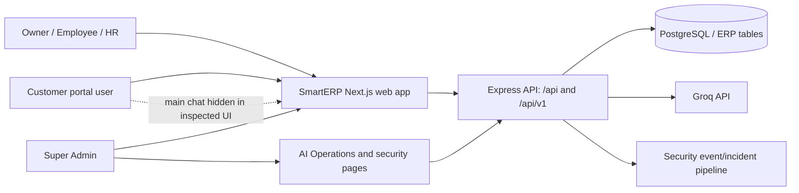
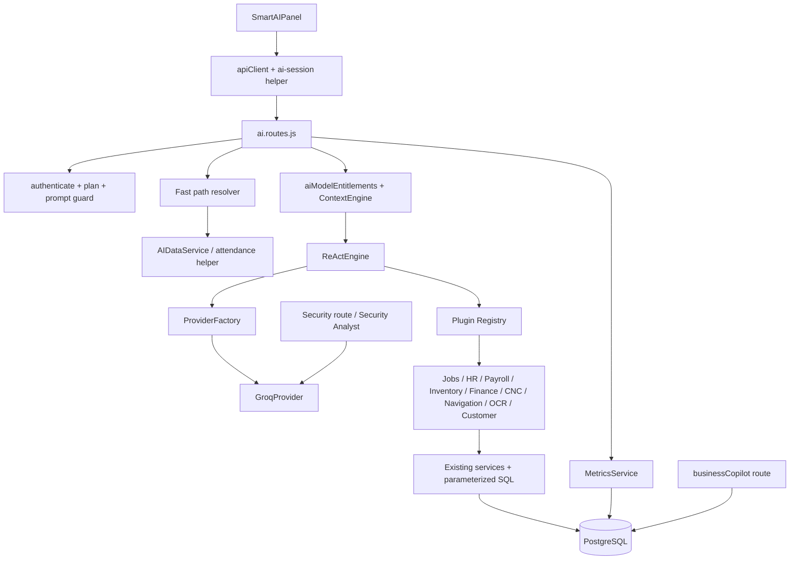
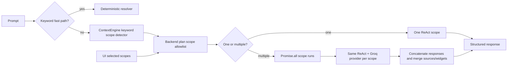
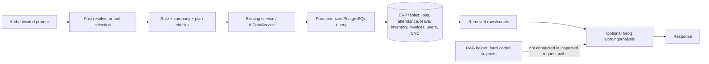
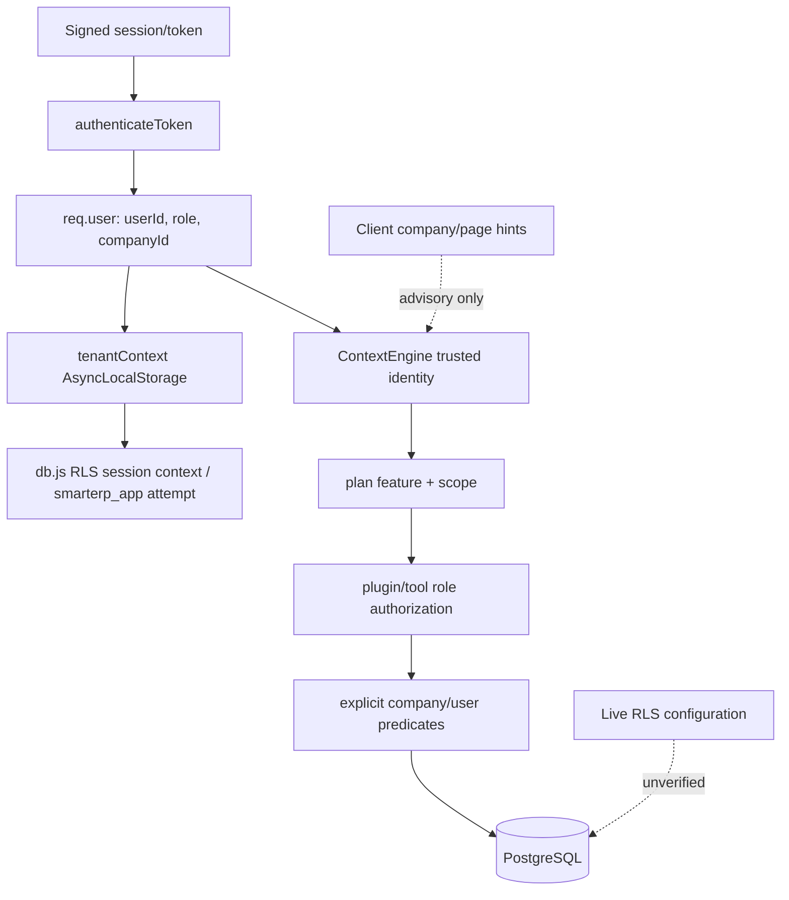
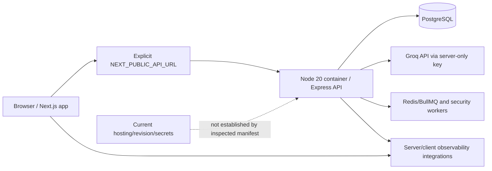

# SmartERP AI — Current-System Discovery

**Inspection date:** 2026-10-23
**Evidence scope:** current checked-out source in `SmartERP-Frontend` and `SmartERP-BackendEnd`, including local uncommitted changes. This is a source audit; it does not establish what is deployed.

## Executive summary

SmartERP has a central authenticated assistant backed by a Groq SDK adapter, a rule-based fast-path layer for common ERP questions, and a ReAct-style tool-calling loop for other requests. The UI calls the backend through the shared API client and renders text, metric widgets, confirmation cards, and allow-listed navigation. Read queries use PostgreSQL-backed services and registered plugins. The same provider and orchestration code serves the selectable business specialist scopes; the current “multi-agent” option fans out several scope runs concurrently and combines the results. It is not a set of independent model providers or autonomous agent services.

Portal coverage is uneven. The shared Smart AI panel is mounted globally, but explicitly hides itself on Customer routes. It is available to signed-in Owner, Employee, HR, and Super Admin users only when the frontend subscription context says `ai_assistant` is enabled. The backend has a `get_customer_summary` tool, but the current customer portal has no visible chat entry point in the inspected frontend. Super Admin has AI Operations statistics/audit pages and separate security-investigation endpoints; that is not the same UI or permission path as the company assistant. These distinctions matter when saying “AI exists in a portal.”

Source-verified strengths include authentication before the primary agent route, backend plan/role checks for tools, company predicates in the common AI data service, employee-assignment filters, prompt sanitization, bounded provider calls, safe error mapping, and tests for several tenant and failure cases. Source-level risks include an older deterministic `/api/ai/copilot` workflow that writes jobs directly after a boolean confirmation, stale subscription-RBAC tests that use obsolete plan names, mismatched legacy AI audit-table definitions combined with request-time DDL, an unused RAG helper containing hard-coded policy text, and uncertain deployed database/RLS/provider state. No production logs, database, provider, or live application were accessed in this task.

## Scope and method

- Read the supplied current-state discovery request.
- Inspected the current frontend and backend files, package manifests and lockfiles, AI route mounts, plugin registry, model scope/plan checks, provider, prompt guard, tenant middleware, data service, migrations, deployment container file, and available test source.
- Did not read `.env` files, print secrets, connect to any database or provider, inspect production logs, modify application code/schema/configuration, or make a deployment claim.
- The worktrees had existing uncommitted changes at inspection time. This document describes those checked-out source contents; the branch and dirty status are recorded in the task context and were preserved. The files do not establish whether those changes have been committed or deployed.
- Test commands and results appear in [Tests and evidence](#tests-and-evidence).

Status labels: **Verified** means visible directly in inspected source or a test that was run. **Source inference** means the path is indicated by static wiring but was not observed at runtime. **Unverified** means it requires a safe staging, database, or deployed-environment check. **Not found** means it was not found in the inspected implementation, not proof that it cannot exist elsewhere.

## Technology and implementation inventory

| Area | Current source evidence | Status |
|---|---|---|
| Frontend | Next.js `^14.2.16` and React `^18.3.1` in `SmartERP-Frontend/package.json`; lockfile resolves Next 14.2.35 and React 18.3.1. TypeScript/TSX and browser JavaScript. | Verified source/lockfile |
| Backend | Node.js JavaScript, Express `^4.18.2` (lock resolves 4.22.1), PostgreSQL through `pg` `^8.11.0` (lock resolves 8.18.0). Container uses Node 20 slim in `SmartERP-BackendEnd/Dockerfile`. | Verified source/lockfile |
| AI SDK/provider | `groq-sdk ^0.7.0` (lock 0.7.0). `GroqProvider` is the provider used by `ProviderFactory`; no second provider adapter is wired to the primary agent. | Verified |
| Orchestration | Repository-local `ReActEngine`, context builder, plugin registry and keyword scope resolver. No LangChain, LangGraph, or external agent framework found in the active path. | Verified |
| Database/business data | PostgreSQL queries through existing services and plugin handlers. The shared database wrapper carries request tenant context. Current database schema, role grants and active RLS policies were not queried. | Source verified; live DB unverified |
| Client HTTP | `lib/apiClient.ts` uses `getApiOrigin()` from `lib/api-environment.mjs`; AI callers use authenticated shared API client. | Verified |
| Secondary services | The backend repository also includes Redis/BullMQ and security worker infrastructure, but their runtime availability and effect on an AI request were not verified here. | Source only |
| Deployment | Backend Dockerfile specifies a Node 20 container. Frontend Next config and API-environment helper are present. No deployment manifest in the inspected repositories establishes the currently deployed revision/host/configuration. | Partially verified |

### Source map

#### Frontend

| File | Responsibility and relationship |
|---|---|
| `SmartERP-Frontend/app/layout.tsx` | Mounts `FloatingActionHub` inside the shared application providers. |
| `SmartERP-Frontend/components/floating-action-hub.tsx` | Current shared AI entry point; renders `SmartAIPanel`. |
| `SmartERP-Frontend/components/smart-ai-panel.tsx` | Main chat, local conversation state/history, plan-aware model selector, intent suggestions, `/api/ai/agent`, `/api/ai/confirm-action`, widgets and navigation. |
| `SmartERP-Frontend/components/smart-ai-robot.tsx` | Robot/avatar visual states; UI only. |
| `SmartERP-Frontend/lib/ai-session-request.mjs` and `.d.mts` | Shared request helper and payload typing for the secondary chat flow; builds portal/page metadata, preserves safe error state, calls agent/action endpoints. |
| `SmartERP-Frontend/components/ai-chat-bot.tsx` | Legacy chat component; found as imported by Owner/HR layout files, but no render site was found outside its definition in the inspected source. |
| `SmartERP-Frontend/components/ai-copilot.tsx` | Legacy alternative chat UI that also calls `/api/ai/agent`; no active mount found in the inspected source. |
| `SmartERP-Frontend/components/ai-copilot-drawer.tsx` | UI for the separate deterministic business-copilot route. No active mount was verified. |
| `SmartERP-Frontend/services/ai.ts` | Legacy API wrapper for `/api/ai/chat`; no active invocation was found in frontend source. |
| `SmartERP-Frontend/components/AIAssistant.tsx`, `ai-actionable-recommendations.tsx`, `ai-voice-input.tsx`, `proactive-ai-insights.tsx`, `voice-input-modal.tsx` | Other AI-related UI/voice/recommendation components; each has separate reachability, and should not be assumed to participate in the main panel flow. `voice-input-modal.tsx` directly calls `/api/ai/agent`. |
| `SmartERP-Frontend/app/[adminRoute]/ai-operations/page.tsx` and `app/superadmin/ai-operations/page.tsx` | Super Admin AI Operations/Audit page; fetches stats and audit logs, not conversational assistance. |
| `SmartERP-Frontend/app/owner/cnc/ai-activity/page.tsx` | Owner CNC AI activity view; queries copilot activity endpoint. |
| `SmartERP-Frontend/tests/ai-session-request.test.mjs` | Tests authenticated client use, error propagation, plan-denial behavior, and action endpoint payload. |
| `SmartERP-Frontend/lib/api-environment.mjs` | Fails closed without explicit environment/API origin; enforces loopback-only development, HTTPS staging without known production API hosts, HTTPS production. This is source behavior, not browser-host-blocking verification. |

The main panel is globally mounted at `app/layout.tsx` and suppresses itself for public and `/customer` routes in `smart-ai-panel.tsx`. The Owner and HR layout source imports `AIChatBot`, but the import is not rendered there; the shared root hub is the current discovered mount. Employee access is through the same root hub. Super Admin is likewise subject to the shared panel's user and subscription checks; a separate admin AI Operations page is definitely present. Whether a Super Admin account sees the chat depends on actual resolved subscription state and was not runtime tested.

#### Backend

| File | Responsibility and relationship |
|---|---|
| `SmartERP-BackendEnd/server.js` | Mounts `routes/ai.routes.js` at both `/api/v1/ai` and `/api/ai` for compatibility; also mounts business copilot under `/api/v1/ai/copilot` and `/api/ai/copilot`. Contains startup database initialization paths outside this AI document's scope. |
| `SmartERP-BackendEnd/routes/ai.routes.js` | Main routes: `POST /agent`, `POST /confirm-action`, `GET /stats`, `GET /audit-logs`, legacy `POST /chat`. |
| `SmartERP-BackendEnd/middleware/aiPromptGuard.js` | Sanitizes new prompts, recent history and UI context; rejects invalid input; emits redacted prompt-injection event metadata. |
| `SmartERP-BackendEnd/ai/gateway/security.shield.js` | Pattern-based prompt threat checks and sanitization (override, secret-exfiltration, destructive SQL, cross-company, delimiter categories). |
| `SmartERP-BackendEnd/ai/context/context.engine.js` | Builds authenticated user/company/role/plan and advisory UI context; creates system prompts; keyword-selects specialist scopes. |
| `SmartERP-BackendEnd/services/aiModelEntitlements.js` | Backend list of selectable scopes by plan and request validation. |
| `SmartERP-BackendEnd/services/aiPluginScope.js` | Maps a selected scope to allowed plugin classes. Present in current working tree. |
| `SmartERP-BackendEnd/ai/planner/ReAct.engine.js` | Builds prompt trajectory, offers registered tools, performs up to three model/tool iterations, gathers navigation and confirmation results. |
| `SmartERP-BackendEnd/ai/providers/provider.factory.js`, `provider.interface.js`, `groq.provider.js` | Provider selection, abstract interface, Groq SDK request/fallback/error mapping. |
| `SmartERP-BackendEnd/ai/plugins/index.js` and `ai/plugins/*.plugin.js` | Tool registry; combines scope, plan, and role filters; executes registered handlers. |
| `SmartERP-BackendEnd/services/aiDataService.js` | Common direct SQL summaries for jobs, attendance, leave, inventory, finance, owner, employee, HR and customer data. |
| `SmartERP-BackendEnd/services/aiAttendanceSummary.js`, `aiMetricAccess.js`, `employeeAssignedJobsResponse.js` | Attendance access policy, role guard for deterministic fast paths, employee assignment response shape. |
| `SmartERP-BackendEnd/utils/aiErrorResponse.js` | Maps internal AI/provider/data/tool errors to safe HTTP responses. |
| `SmartERP-BackendEnd/ai/telemetry/metrics.service.js` | Audit event writes and admin stats/log queries; currently calls `ensureTable()` which creates/alters schema on read/write paths. |
| `SmartERP-BackendEnd/ai/rag/rag.service.js` | Static in-code policy snippets with a string-match fallback; no active import/call found. Not a verified live RAG pipeline. |
| `SmartERP-BackendEnd/routes/businessCopilot.js` | Separate keyword-routed workflow endpoint; deterministic SQL and a job creation flow. Does not use `ReActEngine` or model selection for the shown business workflows. |
| `SmartERP-BackendEnd/ai/securityAnalyst.js`, `routes/security.js`, `ai/plugins/security.plugin.js`, `jobs/securityWorker.js`, `utils/securityEmitter.js` | Separate Super Admin security incident enrichment, read-only security tools, event persistence/worker processing. Not the same as company-facing assistant. |
| `SmartERP-BackendEnd/services/ai.service.js` | Standalone Groq client with a hard-coded model and broad general prompt; no runtime caller found in source. Treat as disconnected/legacy, not active agent provider evidence. |
| `SmartERP-BackendEnd/migrations/018_ai_copilot_and_audit_logs.sql`, `022_cnc_phase3.sql` | AI audit and action/memory table definitions; see database caveats below. |

## Portal coverage

| Portal | Current UI discovered | Backend capability discovered | Evidence status / caveat |
|---|---|---|---|
| Owner | Shared Smart AI floating panel, if signed in and feature enabled. CNC AI activity page exists. | Company summaries; jobs, inventory, finance/GST, payroll, attendance, HR, CNC and confirmed plugin actions subject to role/plan/scope checks. | Source-verified; live account access and deployment unverified. |
| Employee | Shared panel, same global mount. Suggestions and backend deterministic paths include assigned jobs, personal summary, permitted attendance and inventory/jobs. | Employee-assignment queries use authenticated employee ID + company ID; role allowlists remove directory, payroll and other restricted tools. | Source-verified; no browser test in this task. |
| HR | Shared panel, same global mount; HR-specific suggestions. | HR summary and authorized attendance/leave/staff tools; some finance/GST tool definitions allow HR, while hard registry checks treat financial/GST differently. See policy caveat. | Source-verified; role policy should be reviewed against business policy. |
| Customer | Shared panel explicitly hidden on `/customer*`; no customer chat mount found. | `get_customer_summary` exists for a customer and scopes queries by company plus customer ID/email; `businessCopilot` has customer checks but still routes through a separate endpoint. | Backend support is not proof a customer-facing assistant is exposed. |
| Super Admin | Separate AI Operations page queries `/api/ai/stats` and `/api/ai/audit-logs`; AI security incident pages/routes are separate. | `GET /stats` is super_admin-only; audit logs allow owner or super_admin with owner forced to own company. Separate security endpoints invoke `analyzeIncidentWithAI`. | Verified routes/UI source. The SecurityPlugin is registered but `security` is not in `USER_MODEL_SCOPES`, so it is not selectable via `/agent`; its direct route use was not found. |

All customer/company AI paths remain authenticated by server middleware. A company plan entitlement controls feature/scope access; it does not itself grant a role permission. The Super Admin platform-level API is a separate privilege path and must not be mistaken for a company's tenant-scoped AI assistant.

## Current request architecture

The API is mounted at both `/api/v1` and `/api`; the UI currently uses the compatibility `/api` paths. The client sends the last selected history turns and advisory portal/module/page fields. The server derives identity/company from `req.user`; client context does not replace those identity claims.

## Agents, scope routing, models and plans

### Agent and routing semantics

The active conversational agent is one ReAct loop parameterized by a specialist scope. `ContextEngine.detectModelScope()` uses keywords, not an independent classifier. Common requests are intercepted earlier by deterministic route conditions and never invoke an LLM. For one selected scope, one ReAct run is made. For multiple manually selected scopes, the route runs independent `ReActEngine.run()` calls with `Promise.all`, using one provider implementation, and combines the response text. This is parallel specialist fan-out; it does not show cross-agent messages, a supervisor planner, or distinct provider/model routing.

Scopes in the server entitlement set: `general`, `cnc`, `finance`, `inventory`, `attendance`, `payroll`, `hr`, `gst`, `executive`. `security` appears in plugin scope code but not in the allowed user scope list. The UI additionally offers `auto`; `auto` is a selector behavior and is not a model scope.

| Backend plan tier | Allowed scopes in source | UI terminology note |
|---|---|---|
| `starter` | `general` | UI calls general “free”; UI `isFree` is computed from resolved subscription data. |
| `professional` | general, CNC, inventory, attendance, HR | UI refers to “Basic” in selector logic; subscription context maps Professional/basic labels to `isBasic`. |
| `enterprise` | all nine user scopes | UI calls the top tier “Pro” in component state; context maps Enterprise/Pro to `isPro`. |

These are source fallbacks/canonical entitlements, not verified live plan records. `subscriptionCatalog.js` contains source-defined pricing/limits, but plan/database rows were not read. `requireFeature('ai_assistant')` is also applied to agent, chat, confirmation, and copilot routes. `aiQuota.js` is a compatibility shim returning unlimited requests; plan differences are specialist scope access, not per-hour AI message count, in current source.

**Important source-level entitlement gap:** deterministic data fast paths run before `resolveAiModelScopes()` in `routes/ai.routes.js`. Their `canUseAiFastPath()` checks role only (`services/aiMetricAccess.js`), not plan/scope. The route-level `ai_assistant` feature is enabled in the canonical tiers. Therefore an allowed role with AI feature access may receive deterministic payroll, finance, inventory or other fast-path data before specialist-scope plan checks. This is a source-code inference from middleware/order and must be resolved or explicitly approved before treating specialist entitlements as enforced for every direct API request. Tenant/role checks still apply; this finding concerns plan scope, not proof of cross-company access.

### Provider and model details

- `ProviderFactory.getProvider()` selects `GroqProvider` for `AI_PROVIDER=groq` and also falls back to Groq in its default branch. No alternate wired provider adapter was found.
- `GroqProvider` uses server-only `GROQ_API_KEY`; its default identifier is `GROQ_MODEL` or `openai/gpt-oss-120b`. The name identifies a model served through the Groq API, not an OpenAI provider call.
- Fallback candidates in source: `openai/gpt-oss-120b`, `openai/gpt-oss-20b`, `qwen/qwen3.8-27b`, `groq/compound`. For the default route it tries no more than two unique candidates. A caller-supplied explicit `model` tries that model only. A fallback is skipped for provider/account 401, 403, 429, or timeout conditions.
- Groq SDK timeout is 10 seconds, `maxRetries: 0`; the frontend agent call has a 30-second timeout. The ReAct loop caps at three completion iterations. System uses temperature 0.1 in ReAct; provider default is 0.2. Streaming is not enabled in the inspected completion payload.
- `GROQ_MAX_CONCURRENCY` configures an in-process limiter, default 5 concurrent provider calls. Each selected specialist has its own calls, so multi-scope selection can increase total requests. No cost ledger, token budget policy, benchmark, or model-price schedule was verified.
- `GROQ_VISION_MODEL` is referenced by OCR service; OCR is not the same as the chat agent provider flow.
- `services/ai.service.js` constructs another Groq client and hard-codes `llama-3.3-70b-versatile`, but no code caller was found. It is not evidence of the active model.

## Plugin/tool inventory

`ai/plugins/index.js` registers the listed plugins. The registry advertises tools only when selected scope, plan tier and declared `allowedRoles` permit them, and checks those conditions again at execution. Some module-specific authorization is also in the plugin/service. Read-only versus proposal/action is taken from the actual tool intent; tool presence alone is not proof of end-to-end success.

| Plugin / tool names | Purpose and effects | Role/scope evidence |
|---|---|---|
| `LiveSummaryPlugin`: `get_owner_metrics`, `get_employee_personal_summary`, `get_hr_summary`, `get_customer_summary` | Reads company owner, user-personal, HR or customer summary through `AIDataService`. | Explicit role lists in plugin; per-user/company predicates in data service. |
| `JobsPlugin`: `get_jobs`, `get_delayed_jobs`, `create_job` | Reads jobs/delays or returns a create-job confirmation proposal; creation should be submitted through the confirmed-action flow. | Company/employee assignment queries and owner/HR/admin create-role list; inspect plugin handler for schema/action. |
| `EmployeePlugin`: `get_employees`, `create_employee`, `analyze_employee_performance` | Staff directory/read, create proposal and performance analysis. | owner/HR/admin allowlist; execution depends on service and approval path. |
| `AttendancePlugin`: `get_today_attendance`, skill `assess_absenteeism_risk` | Attendance summaries and risk assessment. | Company summary policy permits owner/admin/HR/employee with employee scope restricted; Super Admin/customer are rejected from attendance summary helper. |
| `PayrollPlugin`: `get_payroll_summary`, `calculate_payroll`, `validate_payroll_pre_run` | Payroll reads/calculation/validation. | Tool role allowlist owner/HR/admin; registry hard-blocks other roles. Professional hides `validate` by plan rule. |
| `InventoryPlugin`: `get_low_stock_items`, `get_material_requests`, `get_demand_forecasts` | Low-stock and material request data, forecast. | Role allowlists; company-scoped query/service. Professional plan excludes tool names containing `forecast`. |
| `FinancialPlugin`: `get_revenue_analytics`, `get_unpaid_invoices`, `get_ar_aging_summary` | Finance and receivables. | Tool allowlists plus registry hard guard for financial tools; excluded from Professional by plan. |
| `GSTReconciliationPlugin`: `get_gst_reconciliation_summary`, `list_unmatched_gst_invoices` | GST reconciliation summaries/unmatched invoice list. | Tool allowlists and registry financial/GST guard; Enterprise-only under current registry. |
| `CustomerPlugin`: `get_customers`, `create_customer` | Customer listing and create proposal. | owner/HR/admin list; company service. Not a customer-facing plugin in the current customer panel. |
| `NavigationPlugin`: `navigate_to_route` | Returns an allow-listed route for UI navigation; does not mutate business data. | owner/HR/admin/employee; Super Admin is not in the allowed role list. Destination prefix is selected from authenticated role. |
| `OCRPlugin`: `parse_invoice_document` | Parses uploaded invoice/document content via OCR service. | owner/HR/admin; dependent on OCR provider/service configuration. No OCR live test run. |
| `CncPlugin`: `get_company_machines`, `get_machine_details`, `get_machine_service_history`, `decode_cnc_alarm`, `check_spare_parts_availability`, `check_machine_warranty`, `prepare_service_escalation` | CNC registry/history/alarm/parts/warranty and escalation preparation. | Declared role lists include owner/admin/HR/employee/Super Admin on these tools; deeper service checks and tenant schema require DB integration verification. |
| `SecurityPlugin`: `get_incident_details`, `get_correlated_events`, `get_ip_threat_history`, `get_user_threat_history`, `get_company_security_summary` | Read-only Super Admin security incident/event lookup and redaction. | `allowedRoles: ['super_admin']`, but `security` is absent from model-scope entitlement set, so the standard `/agent` path cannot select it. Separate security analyst route is live in source. |

### Actions, navigation, and confirmation

The main route only emits model-written navigation when a registered navigation tool produced an allow-listed `NAVIGATE` result. The React UI invokes `router.push` using the returned path. Model-created widgets of type `ACTION_CONFIRMATION` are replaced with server-produced confirmation data. `POST /confirm-action` authenticates, checks the AI feature, scans action parameters for prompt injection, rebuilds trusted context and executes the named registered tool with `confirmed: true`. Success is only whatever the real handler returns; the generic UI cannot itself prove external side effects beyond that response.

The separate `businessCopilot.js` is important: it is keyword-routed rather than the main LLM tool loop. `create job`/breakdown/PM requests first return `requires_confirmation`, and a second request with `confirm_action=true` inserts a job then attempts a timeline event. The route does not show an explicit role allowlist for that create-job branch; company association and a job quota are checked. The timeline insert is caught and ignored. No idempotency key is shown for retries. High-risk delete/cancel/close-finance intents are not implemented and return 501 after confirmation. The corresponding drawer exists but an active mount was not verified. Treat these as source risks, not as verified production behavior.

## End-to-end example paths

These are source traces, not observed production requests.

1. **“Show my assigned jobs.”** `SmartAIPanel` posts `/api/ai/agent` with text, client history and portal/page hints. `authenticateToken → loadPlan → requireFeature → validateAiPrompt` runs first. `isEmployeeAssignedJobsPrompt` takes the employee-only deterministic path; it derives employee ID and company ID from `req.user`, calls `AIDataService.getEmployeeAssignedJobs`, and SQL matches both `company_id` and assignment columns. Result is rendered as a message/widget/navigation. Query failure propagates; it is not converted to “no assigned jobs.” Evidence: `routes/ai.routes.js:61-125`, `services/aiDataService.js:32-59`, `services/employeeAssignedJobsResponse.js`.
2. **Attendance overview.** Attendance keywords choose `loadAttendanceSummary`; its helper enforces supported roles/company access; service uses company attendance policy/timezone and queries active company employees, attendance and approved leave. On caught DB/service failure the route returns 503 with a safe message. Evidence: `routes/ai.routes.js:127-187`, `services/aiAttendanceSummary.js`, `services/aiDataService.js:146-181`.
3. **Pending leave.** Exact pending-leave phrases use deterministic SQL count. Employee query includes employee user ID and company; owner/HR/admin path counts within company. Route offers portal-specific navigation. Evidence: `routes/ai.routes.js:358-386`, `services/aiDataService.js:122-138`.
4. **Feature help.** The exact one-word “help” is handled by the greeting fast path. “Contact support”/support/help desk phrases return a fixed support message. Other feature-finding requests go to the model path; `NavigationPlugin` exposes a finite route map. There is no verified general text-search index over every portal feature. Evidence: `routes/ai.routes.js:91-108,389-406`, `ai/plugins/navigation.plugin.js:7-61`.
5. **“Open Assigned Jobs.”** This phrase is not an early deterministic navigation fast path. It proceeds through scope detection/ReAct; if the model calls `navigate_to_route`, the handler maps `assigned_jobs` to the role-based jobs route and returns `NAVIGATE`. The UI uses the server-returned path. If the model does not call the tool, no navigation is guaranteed. Evidence: `ai/context/context.engine.js:268-300`, `ai/plugins/navigation.plugin.js:23-59`, `ai/planner/ReAct.engine.js:189-193`, `smart-ai-panel.tsx:1278-1280`.
6. **Unsupported/ambiguous request.** The plan allows a scope; keyword detection may choose one or fall back to general. The same provider receives system prompt, up to the request's sanitized history, user prompt and available tool schemas; ReAct can run up to three iterations. No separate intent classifier or calibrated confidence model is in this path. Evidence: `routes/ai.routes.js:408-517`, `ContextEngine.detectModelScope`, `ReAct.engine.js:48-80`.
7. **Provider/tool failure.** Provider missing config is mapped to safe 503; Groq call errors are wrapped as provider unavailable. Tool execution errors become `AI_TOOL_EXECUTION_FAILED`; request route logs bounded error name/code and limited PostgreSQL metadata, then uses `getAiErrorResponse`. Frontend maps known statuses/codes to retry-safe text. Evidence: `groq.provider.js:57-74,181-193`, `ReAct.engine.js:161-175`, `routes/ai.routes.js:557-580`, `utils/aiErrorResponse.js`, `smart-ai-panel.tsx:752-789`.

## Data sources, retrieval, and memory

| Source | How it is used | Isolation/freshness |
|---|---|---|
| PostgreSQL jobs | Deterministic job counts, assignment lists, delays and `JobsPlugin` data. | Service uses parameterized company ID; employee views add assignment/user filters. Retrieved at request time (no cache shown in these methods). |
| Attendance/users/leave | Attendance summaries, active staff, personal attendance, approved leave and pending leave. | Company and sometimes user IDs are explicit; attendance summary helper applies role policy and company timezone. Live DB schema/runtime not checked. |
| Inventory/material requests | Low-stock count/items, employee material requests and forecasts via plugin/service. | Company predicate; inventory query uses `inventory_items`, `quantity`, `min_quantity`, non-deleted filter in current low-stock helper. A separate legacy owner dashboard query references `inventory` / `min_stock_level`, so schema compatibility deserves separate review. |
| Invoices/payments/finance | Invoice status and payment aggregates, financial/AR plugin. | Company predicates are present in summary SQL; direct DB and accounting correctness were not verified. |
| Employees/HR/customers/CNC | Existing backend business services and SQL in plugins/AIDataService; customer dashboard summary matches authenticated company plus customer ID/email. CNC uses company machine data. | Role + company checks vary by plugin and are source-reviewed, not proven against deployed RLS. |
| Model pretraining | General language output and broad explanations from provider model. | Not a source of live ERP facts. Prompts instruct no fabrication; tools/fastpaths are the intended live data path. |
| RAG/documents | `ai/rag/rag.service.js` defines four static policy snippets and string matching; no import/call found. It returns all snippets when no match, and includes policy text that is not proven current. | Not a verified RAG/embedding/vector retrieval feature. No document ingestion, embedding/vector store or company knowledge retrieval path found in this search. |
| Conversation history | Main UI stores conversation summaries/messages in browser `localStorage` under user-specific keys, capped at 50 conversations. Requests send at most 10 prior non-typing turns; backend prompt guard retains at most 20 valid incoming turns. | No backend conversation store for the main chat was identified. Browser storage is per user key in the same browser profile; no encryption or cross-device sync shown. Customer UI is hidden. |
| Company memory table | Migration 022 defines `ai_company_memory`. | No active consumer found in inspected AI code; not verified as current model memory. |

There is no verified vector database, embeddings, file/document RAG, or server-side persistent conversation memory in the main agent path. `RAGService` is a stub-like static lookup, not semantic retrieval.

## Tenant, role, and prompt security

1. `authenticateToken` verifies the session/token and constructs `req.user` with trusted ID, role and company information; it can retrieve missing company ID from the user row. Then `setTenantContext` places company, role and user in async request context. Client-provided context is advisory only.
2. `db.js` configures request RLS context and attempts `SET ROLE smarterp_app` when context is present; comments/source describe that role as lacking BYPASSRLS. Actual database role existence, privileges and live policies were not checked.
3. AIDataService SQL usually adds explicit company predicates and filters employee-personal records by ID. Plugins add declared roles and registry enforces role/plan/scope before execution. Some tool-level policy differences remain: e.g. payroll has broad allowed roles but hard registry guard excludes Employee; financial/GST roles differ across plugin definitions and hard guards (finance methods may list HR in some tools while registry's financial/GST rule permits only owner/Super Admin). Also, the deterministic completed-jobs resolver returns company-wide counts to every `canUseAiFastPath('jobs')` role including Employee, and the attendance summary helper explicitly allows Employee into a company-wide aggregate. Whether those aggregate disclosures are approved for Employee users is not established by inspected policy. These differences need owner/security review rather than assumptions.
4. Prompt injection protections use pattern/rule inspection, sanitization, context/history screening, bounded history, and a safe refusal. On blocked threat-like input the guard invokes the security event emitter with metadata (length/category/request ID, company/user IDs, endpoint metadata), not the raw prompt. Successful database persistence and later worker processing were not verified in this task. This is not a model-based classifier and can have false positives/negatives.
5. Confirm-action recursively scans supplied params and only executes a named tool after authenticated context. It should not be described as a complete transaction/idempotency guarantee; those properties depend on each business handler.
6. Super Admin has separate platform-level routes. Role permission does not itself grant company data access, and a company subscription does not grant role permissions.

**Database/RLS evidence boundary:** migrations 018 and 022 define AI audit/action/memory tables, but those files themselves do not enable RLS on those AI tables. Other later policies may exist, but inspected source does not establish the live DB's current policy state. The main AI data queries' explicit tenant predicates are verified in source. Live RLS is **unverified**.

## Prompt, history, errors, audit, and known issues

- Main request: sanitized prompt; up to 20 safe prior items accepted by backend, while current main UI sends up to 10; untrusted prior turns containing detected attacks or overlarge input are omitted. Client portal/module/page labels are sanitized and advisory.
- Error responses: code-specific mapping via `utils/aiErrorResponse.js`; provider and tool failures are not meant to look like successful zero-data results. Frontend shows a retry for retryable errors, 401 sign-in prompt, 403 permission response, prompt refusal, offline and timeout-specific text.
- Deterministic fast paths often return `confidenceScore: 1.0` and labels such as “Live PostgreSQL” without calibration; source proves they query the database, not that the score is statistically measured. LLM confidence is left undefined in ReAct. Don't interpret UI confidence values as validated probabilities.
- Request audit `MetricsService.logAIAuditEvent` calls `ensureTable()` during runtime. Migration 018's `ai_audit_logs` shape (`user_id`, `role`, `prompt`, `action_name`, etc.) differs from the newer runtime's expected columns (`user_role`, `tool_name`, `action_params`, etc.). `ensureTable()` uses `CREATE TABLE IF NOT EXISTS` and additive ALTER statements, swallowing ALTER errors. On an existing older table it does not reconcile the missing base columns. Audit writes are caught, so an answer may succeed while audit persistence is unavailable. The deployment DB schema/runtime result was not checked.
- `/api/ai/agent` additionally inserts `ai_action_audit_trail` but catches insert errors. Metrics collection therefore should not be assumed complete from source alone.
- The route can return a safe provider-unavailable 503/timeout; this task has no request-correlated runtime evidence to attribute current or past errors to Groq, CORS, DB, quota or worker behavior.
- `businessCopilot` writes directly after its confirmation flag, lacks a visible role allowlist on that job-create branch, suppresses timeline-event failure, and does not show idempotent retry behavior. The active UI mount is unverified. It is distinct from the guarded main action-confirmation endpoint.
- Frontend subscription labels and legacy test expectations are not fully aligned with the backend's Starter/Professional/Enterprise tier strings. See test result and plan map above.
- Deterministic AI data fast paths precede specialist scope entitlement resolution and their current helper checks roles but not plan. Lower-tier direct API access to a specialist fast path is therefore a release-relevant entitlement gap in the source candidate.
- Super Admin `SecurityPlugin` tool inventory is registered, but its `security` scope is excluded from the standard user scope allowlist; the separate Security Analyst route is the actual source-supported Super Admin LLM incident-enrichment path.
- No available sanitized production logs were consulted. Screenshots and prior conversation logs are not current source/runtime evidence.

## Configuration and deployment

Environment variable **names only** found on AI paths:

| Name | Use | Exposure |
|---|---|---|
| `AI_PROVIDER` | Provider factory selection; only Groq provider is implemented in the factory. | Server-only |
| `GROQ_API_KEY` | Groq SDK authentication. | Server-only secret; value intentionally not inspected |
| `GROQ_MODEL` | Default model identifier and OCR text model hint. | Server-side configuration |
| `GROQ_VISION_MODEL` | OCR image model identifier. | Server-side configuration |
| `GROQ_MAX_CONCURRENCY` | In-process completion concurrency limit, default 5. | Server-side configuration |
| `NEXT_PUBLIC_APP_ENV`, `NEXT_PUBLIC_API_URL` | Frontend API environment and public origin, validated by `api-environment.mjs`. | Public build configuration, not credentials |

`Dockerfile` shows a two-stage Node 20 slim backend container. The frontend configuration is Next.js; no verified deployment manifest was found establishing currently live frontend/backend hosts or revision. Current source helper permits only loopback for development, requires HTTPS and blocks known production hosts in staging, and requires HTTPS in production. Environment values and hosting control-plane settings were not read. Database availability, deployed migrations, provider account quota and secret correctness remain unverified.

## Performance, cost, and scaling

- Model request count: zero for greeting and deterministic fast paths; at least one completion for a ReAct run; up to three completion iterations per scope. Multi-scope mode runs scopes concurrently and can multiply calls. Tool calls are executed sequentially inside each ReAct iteration despite a nearby comment saying “in parallel.”
- Provider timeout 10 seconds, no SDK retries; up to one fallback candidate for the default-model path; front-end agent request timeout 30 seconds. Other HTTP routes may have server-wide rate limiters, but no exact AI-specific rate limit was verified in the selected route.
- Groq provider process limiter default 5 (`GROQ_MAX_CONCURRENCY` can configure it); this is per process, not a distributed global quota.
- No streaming in active `GroqProvider` completion payload. No verified semantic cache for model responses. Main chat history is client-side only.
- Token count/cost, provider billing, actual call latency, concurrency in production, and scaling capacity are unknown. Metrics code attempts to record latency/model scope but storage compatibility is unresolved.

## Tests and evidence

### Commands run in this task

| Command | Result |
|---|---|
| Backend: `node --test tests/aiAssignedJobs.test.js tests/aiAttendanceSummaryAccess.test.js tests/aiDataServiceTenantScope.test.js tests/aiLowStockInventory.test.js tests/aiModelEntitlements.test.js tests/aiPromptGuard.test.js tests/aiProviderAvailability.test.js tests/aiQuota.test.js tests/aiReliability.test.js` | **50 passed, 0 failed**. Unit/mocked or source-contract tests; no production DB/provider. |
| Backend: `node tests/ai.tenant.test.js` | **Passed** (three printed checks: prompt cross-company refusal, server JWT company binding, fail-closed service company requirement). Service checks call with null company IDs; no business DB query. |
| Frontend: `node --test tests/ai-session-request.test.mjs` | **6 passed, 0 failed**. Mocked API client; no browser or backend request. |
| Backend: `node --test tests/ai_subscription_rbac.test.js` | **Failed / interrupted.** Output showed three plan-gating/RBAC expectations fail while context-advisory and company-context assertions pass. The process then remained alive after emitting `Redis [cmd] connected` and was interrupted with Ctrl+C (exit 1). The test uses old `free/basic/pro` labels while canonical entitlements are `starter/professional/enterprise`; a clean standalone test exit was not obtained. |

The tests above are not PostgreSQL/RLS, Groq live, browser, end-to-end, email, or production tests. No UI browser verification, cross-tenant DB test against two actual companies, model call, or security worker persistence test was performed in this documentation task.

### Test inventory (not all run)

AI-focused backend test files found: `aiAssignedJobs.test.js`, `ai.tenant.test.js`, `aiProviderAvailability.test.js`, `aiPromptGuard.test.js`, `aiModelEntitlements.test.js`, `aiLowStockInventory.test.js`, `aiDataServiceTenantScope.test.js`, `aiAttendanceSummaryAccess.test.js`, `aiQuota.test.js`, `aiReliability.test.js`, `ai_subscription_rbac.test.js`, `phase1_security_ai_verification.test.js`, `phase4_security_analyst.test.js`, `phase7_e2e_and_hardening.test.js`, `promptInjectionResponse.test.js`. Some `phase*` names indicate integration intent; inspect their actual setup before running because certain suites use `.env`, database records, worker queues or provider calls. They were not run here.

Frontend AI tests found: `tests/ai-session-request.test.mjs`. No browser/e2e AI test was found in this focused inventory.

## Architecture diagrams

### 1. System context



### 2. Component/service architecture



### 3. Full request lifecycle

```mermaid
flowchart TD
  A[Submit] --> B[POST /api/ai/agent]
  B --> C[Authenticate token]
  C --> D[Load plan and ai_assistant gate]
  D --> E[Validate/sanitize prompt, history, UI context]
  E --> F{Fast-path phrase and role allowed?}
  F -->|yes| G[Company/user-scoped service query]
  G --> J[Structured JSON response]
  F -->|no| H[Resolve entitled scope(s)]
  H --> I[Build trusted context/system prompt]
  I --> K[Groq ReAct max 3 iterations]
  K --> L{Tool call?}
  L -->|yes| M[Scope/plan/role guard, execute plugin]
  M --> K
  L -->|no| N[Text + server-confirmed widget/nav]
  N --> J
  J --> O[Render message/card/nav]
  K --> P[Safe error map and retry state]
```

### 4. Multi-agent/scope routing



### 5. Data retrieval/source of truth



### 6. Tool/action confirmation

```mermaid
sequenceDiagram
  participant LLM as Groq model
  participant ReAct as ReActEngine
  participant Reg as PluginRegistry
  participant UI as SmartAIPanel
  participant Confirm as POST /confirm-action
  participant Handler as Plugin handler
  LLM->>ReAct: tool name + JSON arguments
  ReAct->>Reg: execute(name,args,authenticated context)
  Reg->>Reg: scope + plan + role guard
  Reg->>Handler: execute permitted tool
  Handler-->>ReAct: data or ACTION_CONFIRMATION_REQUIRED
  ReAct-->>UI: text/widget; only server tool reference is confirmable
  UI->>Confirm: user confirms tool reference + params
  Confirm->>Confirm: authenticate + plan + injection scan
  Confirm->>Reg: execute with confirmed=true
  Reg-->>UI: actual handler response / safe failure
```

### 7. Authentication/tenant boundary



### 8. Deployment and external dependencies



## Known gaps and safe next verification

| Finding | Confidence | Safe next evidence |
|---|---|---|
| Main panel hides Customer portal despite customer summary plugin. | Verified source | Product decision: whether to expose a customer assistant; no change made. |
| “Multi-agent” is same provider + parallel specialist scopes; no independent agents/providers. | Verified source | If needed, trace live request logs with redacted correlation IDs in staging. |
| UI plan terminology Basic/Pro differs from backend Professional/Enterprise; old RBAC test is stale. | Verified source/test | Align the test contract after owner approves labels; do not infer live plan rows. |
| AI audit schema definitions differ and telemetry performs request-time DDL with swallowed ALTER failures. | Verified source; database outcome unknown | Compare migrations and schema on an approved read-only/staging DB; move DDL to reviewed migration separately. |
| AI action audit/memory migrations do not themselves show RLS enablement. | Verified migration text; live state unknown | Inspect table RLS/grants/policies in confirmed disposable or approved read-only DB. |
| Legacy business copilot job write confirmation may allow broader roles and non-idempotent retries. | Verified route source; UI reachability unknown | Decide intended role policy; add mocked and disposable DB tests before relying on this workflow. |
| RAG helper and standalone Groq service appear disconnected. | Source search | Verify with full repository reference/build instrumentation if considering removal; no cleanup performed. |
| Current deployed version, config, live Groq availability, database schema/RLS and error causes. | Unverified | Correlate deployment revision, sanitized logs and staging health checks; never infer from local source. |

## Glossary

- **Agent**: conversational orchestration here means the ReAct loop plus one specialist scope; not an independent deployed service.
- **Scope/specialist**: backend category such as attendance or inventory that filters prompts/tools and may affect plan entitlement.
- **Fast path**: deterministic backend resolver that answers selected common prompts without calling an LLM.
- **Plugin/tool**: registered function schema and server handler offered to the model; backend checks still apply before execution.
- **ReAct**: bounded model/tool loop: reason, optional tool call, return tool result to the provider, produce final response.
- **RAG**: retrieval-augmented generation. The repository contains a static string-matching helper, not a verified vector/RAG pipeline.
- **Tenant/company scope**: authenticated company context used to restrict data retrieval; it is separate from role permissions and subscription features.
- **Action confirmation**: a server-identified tool proposal requiring a separate authenticated request from the user before the handler executes.
- **Source verified**: present in inspected code; it does not imply deployed or runtime verified.
