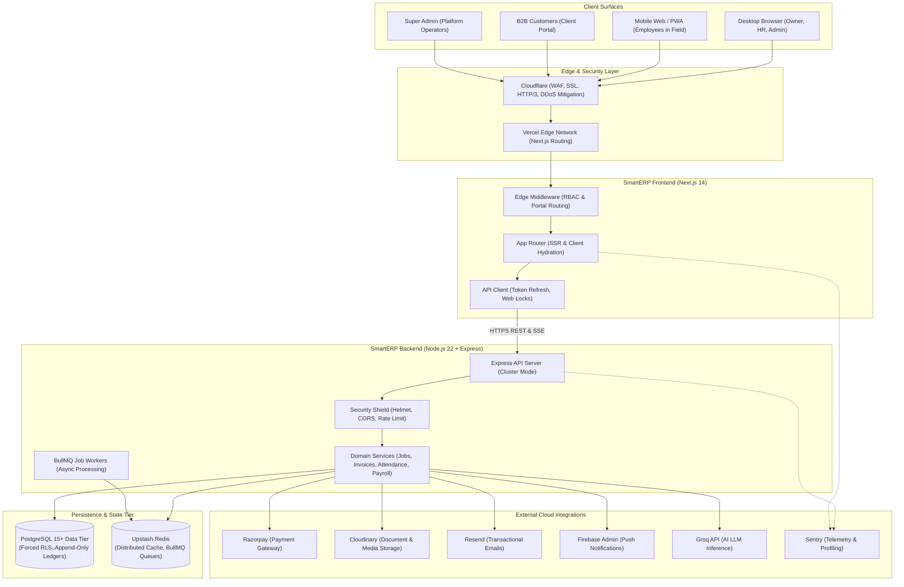
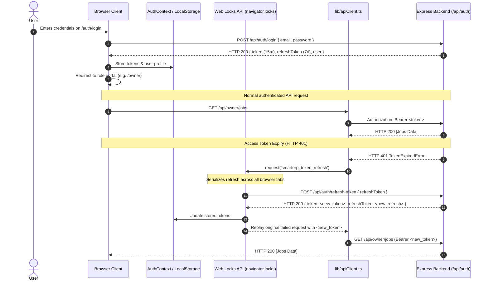
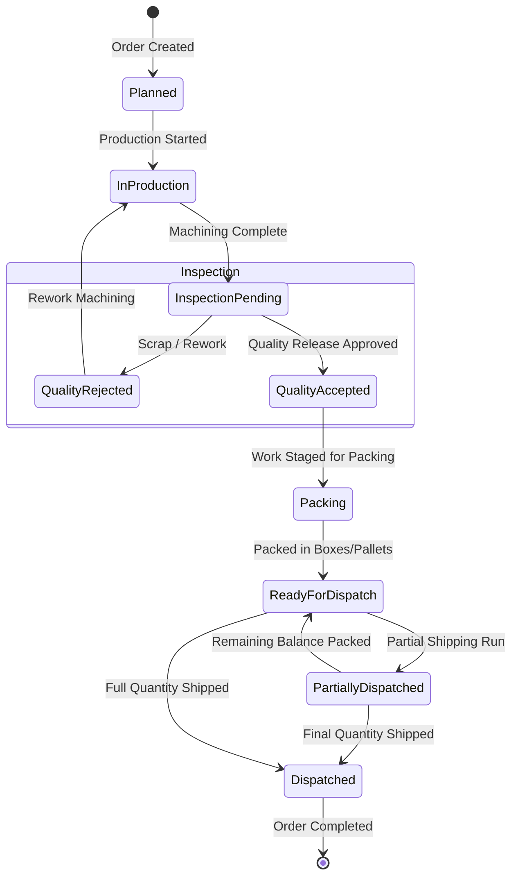
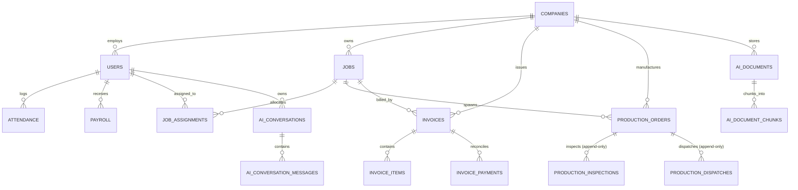
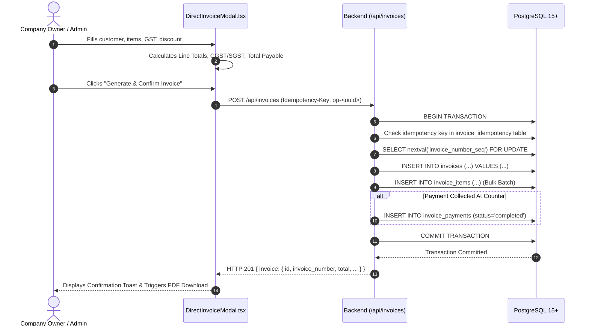
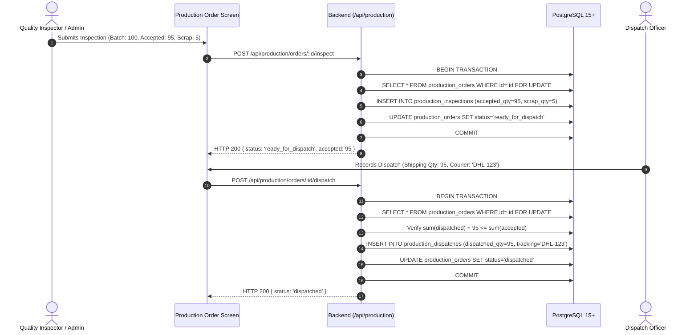

# SmartERP Backend Architecture & Frontend Architecture

> **Document Type:** Master Architectural Specification & System Blueprint  
> **System Name:** SmartERP (Commercial Branding: **Prozync**)  
> **Target Audience:** Principal Architects, Lead Engineers, DevSecOps Engineers, Technical Reviewers  
> **Classification:** Technical Reference Document  
> **Status:** Verified Active Implementation (Branch: `launch-hardening`)  

---

## Executive Table of Contents

- [Part I — Executive and Product Architecture](#part-i--executive-and-product-architecture)
- [Part II — Frontend Architecture](#part-ii--frontend-architecture)
- [Part III — Backend Architecture](#part-iii--backend-architecture)
- [Part IV — Super Admin and Every Role/Portal](#part-iv--super-admin-and-every-roleportal)
- [Part V — Business Modules and End-to-End Workflows](#part-v--business-modules-and-end-to-end-workflows)
- [Part VI — Database and Data Architecture](#part-vi--database-and-data-architecture)
- [Part VII — Security Architecture](#part-vii--security-architecture)
- [Part VIII — Integrations and External Services](#part-viii--integrations-and-external-services)
- [Part IX — DevOps, Deployment and Operations](#part-ix--devops-deployment-and-operations)
- [Part X — API Contracts and Sequence Diagrams](#part-x--api-contracts-and-sequence-diagrams)
- [Part XI — Testing, Quality and Verification](#part-xi--testing-quality-and-verification)
- [Part XII — Technical Debt and Evolution Roadmap](#part-xii--technical-debt-and-evolution-roadmap)
- [Part XIII — Complete Technical Reference Index](#part-xiii--complete-technical-reference-index)

---

# Part I — Executive and Product Architecture

## 1.1 Product Purpose & Scope
SmartERP is a cloud-native, multi-tenant Enterprise Resource Planning (ERP) platform designed specifically for precision engineering, computer numerical control (CNC) manufacturing facilities, custom fabrication plants, and industrial field service organizations. 

Traditional enterprise ERPs (e.g. SAP, NetSuite) present prohibitive licensing costs, extensive onboarding cycles, and bloated generic workflows that fail to capture the high-velocity, precision-critical nature of small-to-medium manufacturing. SmartERP resolves this operational gap by integrating:
- **Commercial & Financial Operations:** Instant walk-in invoice creation, statutory GST compliance (CGST, SGST, IGST), accounts receivable aging, and integrated digital payment collection.
- **Factory Floor & Production Execution:** Job order tracking, machine-level scheduling, quality inspection gating (accepted, scrap, rework), packaging, and dispatch ledgers.
- **Workforce & Labor Governance:** GPS-geofenced mobile clock-in/out, biometric verification, overtime/late penalty calculation, and payroll pre-run audits.
- **Customer Self-Service:** Direct B2B client portal for machine maintenance requests, real-time stage tracking, and online invoice settlement.
- **AI Operational Assistance:** Retrieval-Augmented Generation (RAG) assistant delivering company-isolated operational insights with verifiable citations.

## 1.2 System Boundaries & Context
The SmartERP ecosystem consists of two primary custom application services integrated with vetted third-party cloud infrastructure:



## 1.3 Business Capabilities Matrix
| Domain Capability | Owner / Admin | HR Officer | Field Employee | B2B Customer | Super Admin |
| :--- | :---: | :---: | :---: | :---: | :---: |
| **Direct & Walk-In Invoicing** | Full Control | Read-Only | Denied | Denied | Platform Audit |
| **GST Tax Computation & Filings** | Full Control | Denied | Denied | Denied | Platform Audit |
| **CNC Job Order Scheduling** | Full Control | Denied | View Assigned | Create Request | Platform Audit |
| **Quality Inspection & Dispatch** | Full Control | Denied | Execute Steps | Track Progress | Platform Audit |
| **Attendance Clock-In/Out** | Audit / Adjust | Full Audit | Geofenced Punch | Denied | Denied |
| **Payroll Calculation & Release** | Full Control | Draft Review | View Payslips | Denied | Denied |
| **Customer Machine Registry** | Manage All | Denied | View Assigned | Manage Owned | Platform Audit |
| **Tenant Provisioning & Suspension** | Denied | Denied | Denied | Denied | Full Control |
| **AI Assistant & Document RAG** | Full Access | Denied | Denied | Denied | System Health |

---

# Part II — Frontend Architecture

## 2.1 Technology Stack & Rendering Paradigm
- **Framework:** Next.js `14.2.35` utilizing React `18.3.1` and TypeScript `5.x`.
- **Rendering Strategy:** Hybrid architecture combining Server Components (`RSC`) for marketing pages, terms, and static layouts, with interactive Client Components (`'use client'`) for stateful operational dashboards, data grids, and modals.
- **Styling Architecture:** Tailwind CSS `v4.1.16` compiled via `@tailwindcss/postcss`. Design tokens are bound to HSL CSS variables supporting instant theme switching (`next-themes`) without client flashing.
- **UI Primitives:** Radix UI unstyled, accessible primitives (`@radix-ui/react-*`), Lucide React icons, and Sonner toasts.

## 2.2 Directory Structure
```text
SmartERP-Frontend/
├── app/                          # Next.js App Router root
│   ├── auth/                     # Authentication pages (login, register, forgot-password)
│   ├── customer/                 # B2B Customer Portal (jobs, machines, invoices)
│   ├── employee/                 # Employee Portal (time-tracking, assigned jobs, messages)
│   ├── hr/                       # HR Hub (attendance ledger, employee directory)
│   ├── owner/                    # Company Owner Portal (60+ operational screens)
│   ├── superadmin/               # Master Platform Admin Portal
│   ├── layout.tsx                # Root layout mounting Theme & Context Providers
│   ├── page.tsx                  # Public SaaS landing page
│   └── pricing/                  # Plan tiers and billing comparison
├── components/                   # Component architecture
│   ├── ui/                       # Radix UI + Tailwind design system primitives
│   ├── direct-invoice-modal.tsx  # Responsive Walk-In Invoice Generator
│   ├── smart-clock-in-out.tsx    # GPS-geofenced mobile attendance component
│   └── enterprise-chat-window.tsx# Real-time WebSocket / SSE chat interface
├── contexts/                     # React Context State Providers
│   ├── auth-context.tsx          # JWT session, refresh queue, namespace guard
│   ├── job-context.tsx           # Work order lifecycle and state synchronization
│   └── notification-context.tsx  # SSE connection management and message deduplication
├── lib/                          # Core frontend libraries
│   ├── apiClient.ts              # Typed API client with Web Locks and token refresh
│   └── utils.ts                  # Classnames merge (`clsx` + `tailwind-merge`)
├── public/                       # PWA manifest, service worker, icons, SVG assets
└── tests/                        # Automated unit, responsive, and contract test suites
```

## 2.3 Authentication & Session Lifecycle


## 2.4 Verified Page & Screen Inventory
The frontend implements **147 distinct page routes** (compiling into 130 static pre-rendered HTML shells plus dynamic server-rendered routes in Next.js production builds):
1. **Public & Auth Routes (11 pages):** `/`, `/about`, `/contact`, `/features`, `/pricing`, `/terms`, `/privacy`, `/suspended`, `/auth/callback`, `/auth/login`, `/auth/login/register`.
2. **Owner Routes (51 pages):**
   - Operations: `/owner`, `/owner/jobs`, `/owner/jobs/[id]`, `/owner/jobs/[id]/invoice-editor`, `/owner/customer-jobs`, `/owner/tracking`.
   - Finance: `/owner/finance`, `/owner/finance/invoices`, `/owner/finance/payments`, `/owner/finance/accounts-receivable`, `/owner/finance/gst`, `/owner/finance/gst-reports`, `/owner/finance/gst-reconciliation`, `/owner/finance/reports`.
   - Manufacturing & CNC: `/owner/production`, `/owner/machines`, `/owner/machines/[id]`, `/owner/materials`, `/owner/manufacturing-requests`, `/owner/cnc/command-center`, `/owner/cnc/ai-activity`, `/owner/cnc/automations`, `/owner/cnc/bi`, `/owner/cnc/sla`, `/owner/cnc/vendors`, `/owner/cnc/warranty`.
   - Workforce: `/owner/employees`, `/owner/attendance`, `/owner/attendance/[userId]`, `/owner/payroll`, `/owner/payroll/pre-run-validation`, `/owner/hr-hub`, `/owner/documents`, `/owner/documents/[employeeId]`.
   - Settings & System: `/owner/settings`, `/owner/billing`, `/owner/remote-support`, `/owner/support`, `/owner/notifications`, `/owner/messages`.
3. **HR Routes (21 pages):** `/hr`, `/hr/attendance`, `/hr/employees`, `/hr/payroll`, `/hr/messages`, `/hr/notifications`, and departmental record views.
4. **Customer Routes (20 pages):** `/customer`, `/customer/jobs`, `/customer/jobs/[id]`, `/customer/machines`, `/customer/invoices`, `/customer/chat`, `/customer/notifications`, `/customer/profile`, and service request workflows.
5. **Employee Routes (18 pages):** `/employee`, `/employee/jobs`, `/employee/jobs/[id]`, `/employee/time-tracking`, `/employee/attendance`, `/employee/messages`, `/employee/profile`, `/employee/notifications`, and daily job instruction cards.
6. **Super Admin Routes (13 pages):** `/superadmin`, `/superadmin/login`, `/superadmin/companies`, `/superadmin/companies/[companyId]`, `/superadmin/users`, `/superadmin/billing`, `/superadmin/analytics`, `/superadmin/system-health`, `/superadmin/ai-operations`, `/superadmin/announcements`, `/superadmin/security`, `/superadmin/feedback`, `/superadmin/settings`.
7. **Backwards-Compatible Dynamic Admin Aliases (13 pages):** `/[adminRoute]/*` route tree preserving backwards compatibility for legacy links.

---

# Part III — Backend Architecture

## 3.1 Framework & Runtime Design
SmartERP Backend is powered by **Node.js 22 LTS** and **Express.js 4.18.2**. The server initialization in [`server.js`](file:///c:/Users/ADMIN/Desktop/SMARTERP/SmartERP-BackendEnd/server.js) implements:
- **Graceful Shutdown & Signal Trapping:** Handles `SIGTERM` and `SIGINT` by stopping incoming HTTP connections, allowing in-flight requests 10 seconds to finish, and releasing database pools cleanly.
- **Cluster Multi-Core Utilization:** Supports process clustering across available CPU cores with master-worker IPC.
- **Security Middleware Chain:**
  1. `helmet`: Configures strict HTTP headers (HSTS, X-Content-Type-Options, Frameguard).
  2. `cors`: Dynamic origin validation rejecting wildcards for credentialed requests.
  3. `express-rate-limit`: Per-IP sliding-window rate limiting backed by Redis.
  4. `cookieParser` & `express.json({ limit: '10mb' })`: Safe body parsing.

## 3.2 Dual-Layer Multi-Tenancy Architecture
Multi-tenancy is enforced at both the application tier and the database engine tier:

```
[ Incoming Request ]
         │
         ▼
[ JWT Authentication Middleware (middleware/auth.js) ]
  - Decodes token, verifies cryptographic signature.
  - Extracts authenticated: userId, companyId, role.
         │
         ▼
[ Tenant Context Middleware (middleware/tenantContext.js) ]
  - Enforces mandatory companyId presence.
  - Injects companyId into request context: req.companyId = companyId.
         │
         ▼
[ AsyncLocalStorage & Pool Context Hook (db.js) ]
  - Binds connection checkout to execute session context:
    SELECT set_config('app.current_company_id', $1, true);
    SELECT set_config('app.current_user_id', $2, true);
    SELECT set_config('app.current_role', $3, true);
         │
         ▼
[ PostgreSQL Row-Level Security (RLS) Engine ]
  - Evaluates table policies:
    USING (company_id = current_setting('app.current_company_id', true))
    WITH CHECK (company_id = current_setting('app.current_company_id', true))
```

## 3.3 Core API Route Inventory
| Endpoint Path | HTTP Method | Handler Function | Security & Role Requirements | Purpose |
| :--- | :---: | :--- | :--- | :--- |
| `/api/auth/login` | `POST` | `authController.login` | Public | Authenticates credentials, returns JWT pair |
| `/api/auth/refresh-token` | `POST` | `authController.refresh` | Public | Rotates refresh token, issues new access token |
| `/api/auth/reset-password-request` | `POST` | `authController.forgotPassword` | Public | Sends SHA-256 hashed OTP via Resend email |
| `/api/invoices` | `POST` | `invoices.createDirect` | JWT (`owner`, `admin`) | Generates direct walk-in invoice with GST calculations |
| `/api/invoices` | `GET` | `invoices.list` | JWT (`owner`, `admin`) | Lists invoices scoped to authenticated `company_id` |
| `/api/production/orders` | `POST` | `production.createOrder` | JWT (`owner`, `admin`) | Creates manufacturing work order for CNC processing |
| `/api/production/orders/:id/inspect` | `POST` | `production.inspect` | JWT (`owner`, `admin`, assigned) | Records quality inspection in append-only ledger |
| `/api/production/orders/:id/dispatch`| `POST` | `production.dispatch` | JWT (`owner`, `admin`, assigned) | Records dispatch quantity in append-only ledger |
| `/api/attendance/clock-in` | `POST` | `attendance.clockIn` | JWT (All Staff) | Validates GPS coordinates and records arrival |
| `/api/attendance/clock-out` | `POST` | `attendance.clockOut` | JWT (All Staff) | Records departure, calculates shift working hours |
| `/api/payroll/calculate` | `POST` | `payroll.calculate` | JWT (`owner`, `admin`) | Executes deterministic salary algorithm |
| `/api/ai/documents` | `POST` | `aiPersistence.upload` | JWT (`owner`, `admin`) | Ingests document, extracts plain-text, indexes chunks |
| `/api/ai/documents/search` | `POST` | `aiPersistence.search` | JWT (`owner`, `admin`) | Searches tenant documents via tsvector keyword search |
| `/api/notifications/sse` | `GET` | `notifications.sseStream`| JWT (All Authenticated) | Real-time Server-Sent Events stream for alerts |

---

# Part IV — Super Admin and Every Role/Portal

## 4.1 Role Hierarchy & Permission Boundaries
SmartERP implements a non-overlapping, strictly partitioned permission model:

```
                      [ Super Admin ] (Platform Level)
                             │
            ┌────────────────┴────────────────┐
            ▼                                 ▼
    [ Company Tenant A ]              [ Company Tenant B ]
            │                                 │
     [ Company Owner ]                 [ Company Owner ]
            │                                 │
     [ Company Admin ]                 [ Company Admin ]
      ┌─────┴─────┐                     ┌─────┴─────┐
      ▼           ▼                     ▼           ▼
   [ HR ]    [ Employee ]            [ HR ]    [ Employee ]
      │           │                     │           │
      └─────┬─────┘                     └─────┬─────┘
            ▼                                 ▼
   [ B2B Customers ]                 [ B2B Customers ]
```

## 4.2 Super Admin Deep Dive
- **Authentication:** Dedicated portal entry point at `/superadmin/login` restricted in production to authorized hosts. Super admin tokens carry `role: 'super_admin'` and null `company_id`.
- **Tenant Management (`/superadmin/companies`):**
  - Instant company provisioning, domain mapping, and primary owner credential issuance.
  - Administrative tenant suspension (setting `companies.status = 'suspended'`). Suspended tenants are intercepted at the middleware boundary and redirected to `/suspended`.
- **System Health Telemetry (`/superadmin/system-health`):**
  - Database pool statistics (total connections, active checkouts, idle connections).
  - Redis memory utilization and BullMQ failed job telemetry.
  - Sentry exception aggregates and response time latency percentiles (p50, p95, p99).
- **Security Audit Logs (`/superadmin/security`):**
  - Inspection of `security_events` table (recording brute-force login attempts, OTP mismatches, and unauthorized cross-tenant query rejections).

## 4.3 Company Owner & Admin Deep Dive
- **Capabilities:** Unrestricted authority within their assigned `company_id`. Owners manage company billing, bank details, GSTIN configuration, staff compensation, and invoice generation.
- **Data Scoping:** Bound by database Row-Level Security. An owner cannot view data belonging to another tenant, even if knowledge of the foreign company ID exists.
- **Financial Authority:** Only owners and admins can authorize salary disbursements, delete draft invoices, or approve manual attendance adjustments.

## 4.4 Human Resources (HR) Deep Dive
- **Capabilities:** Manages day-to-day employee operations: employee directory additions, shift scheduling, leave approvals, and attendance audits.
- **Restrictions:** Explicitly blocked from viewing company bank balances, issuing tax invoices, executing customer refunds, or accessing Super Admin settings.

## 4.5 Field & Factory Employee Deep Dive
- **Capabilities:** Assigned work visibility, step-by-step job execution, material consumption logging, and mobile GPS clock-in/out.
- **Restrictions:** Read-only access restricted strictly to jobs where `job_assignments.employee_id = authenticated_user_id`. Cannot inspect customer invoices, coworker salaries, or company financial dashboards.

## 4.6 B2B Customer Deep Dive
- **Capabilities:** Dedicated portal access at `/customer`. View machinery registered to their account, submit repair/service tickets, track active job order progression, and pay invoices via Razorpay.
- **Restrictions:** Absolutely isolated from internal factory notes, employee shift rosters, material purchase prices, and other customers' data.

---

# Part V — Business Modules and End-to-End Workflows

## 5.1 Finance, GST Invoicing & AR Collections
- **Direct & Walk-In Invoicing:** Supports direct sales to walk-in clients without prior quote creation.
- **Automated GST Splitting:**
  - Intra-State Sales (Company State == Customer State): Computes equal 50/50 split between **CGST** and **SGST**.
  - Inter-State Sales (Company State != Customer State): Computes **IGST** at the full statutory rate.
- **Financial Rounding Precision:** Calculations adhere to standard accounting rounding (round half up to 2 decimal places), with integer paise calculations during Razorpay signature creation.
- **AR Aging Buckets:** Automatically categorizes outstanding balances into 0–30 days, 31–60 days, 61–90 days, and 90+ days overdue.

## 5.2 CNC Manufacturing, Quality Release & Dispatch

- **Append-Only Quality Ledger:** Every inspection event records inspector ID, accepted quantity, scrap quantity, rework quantity, and timestamp into `production_inspections`.
- **Immutable Dispatch Tracking:** Dispatches record courier tracking, vehicle numbers, and shipment quantities into `production_dispatches`.

## 5.3 Workforce, Biometric Attendance & Payroll
- **Geofenced Clock-In:** Mobile client captures `(latitude, longitude)`. Backend computes haversine distance against configured company factory coordinates; punches exceeding the allowed radius (default: 200m) are flagged or blocked.
- **Automated Late / Half-Day Detection:**
  - Arrival after 9:00 AM IST: Tagged `late`.
  - Arrival after 1:00 PM IST or departure before 7:00 PM IST: Tagged `half_day`.
- **Deterministic Payroll Calculation:**
  $$\text{Net Salary} = \text{Base Salary} + \text{Allowances} + \text{Increments} - \text{Deductions} - \text{Unpaid Leaves} \times \left(\frac{\text{Base}}{30}\right)$$

## 5.4 AI Copilot, Document RAG & Persistent Chat
- **Document Chunking:** Plain-text documents and Markdown files are partitioned into bounded chunks (max 140 chars overlap) via [`services/aiDocumentPipeline.js`](file:///c:/Users/ADMIN/Desktop/SMARTERP/SmartERP-BackendEnd/services/aiDocumentPipeline.js).
- **Search Vector Indexing:** Database generates stored `tsvector` using the `'simple'` text search configuration with GIN index acceleration.
- **Untrusted Prompt Protection:** Retrieved document chunks are wrapped in strict boundary delimiters instructing the LLM to treat them purely as untrusted data reference, preventing prompt injection attacks from malicious uploaded files.

---

# Part VI — Database and Data Architecture

## 6.1 Database Engine & Connection Strategy
- **Engine:** PostgreSQL 15+ (verified on PostgreSQL 17.6 on `aarch64` Linux).
- **Pool Management:** Managed via `pg.Pool` with SSL mode auto-resolution (`rejectUnauthorized: false` for managed cloud environments such as Supabase / Render).
- **Transaction Safety:** Multi-statement financial, production, and AI operations wrap queries in `BEGIN ... COMMIT` blocks with explicit table and row locks.

## 6.2 Entity-Relationship Diagram (Core Relational Schema)


## 6.3 Complete Migration History Ledger (48 Forward Migrations, 57 SQL Files Total)
The backend maintains **48 forward numbered migrations** (including 016b, 021b, and 046) plus 9 legacy/support scripts (57 SQL files total) tracked via SHA-256 hashes in `app_migration_history`:
1. `001_hardening_indexes_and_migration.sql`: Core performance B-Tree indexes.
2. `002_fix_approval_nulls.sql`: Work request approval state normalization.
3. `003_otp_hashing.sql`: Salted SHA-256 OTP credential storage.
4. `004_internal_messaging.sql`: Real-time staff communication schema.
5. `005_messaging_phase2.sql`: Media attachments and read receipts.
6. `006_gst_reconciliation.sql`: GSTR-1 and GSTR-3B tax summary tables.
7. `007_inventory_forecasting.sql`: Material consumption and reorder points.
8. `008_ar_collections.sql`: Accounts receivable aging buckets.
9. `009_payroll_validation.sql`: Pre-run payroll constraint checks.
10. `010_crm_sales_agent.sql`: Customer lead pipeline tracking.
11. `011_standardize_uuid_and_core_rls.sql`: UUID standardization and initial RLS enablement.
12. `012_fix_company_settings_company_id_type.sql`: Company key type consistency.
13. `013_feedback_enhanced_columns.sql`: Superadmin customer feedback tracking.
14. `014_job_actions_system.sql`: State machine for job execution stages.
15. `015_finance_and_invoicing_system.sql`: Comprehensive tax invoice schema.
16. `016_direct_walkin_invoices.sql`: Walk-in customer invoicing.
17. `016b_unified_work_requests.sql`: Universal work request approval center.
18. `017_enterprise_rbac_and_state_machine.sql`: Enterprise role taxonomy.
19. `018_ai_copilot_and_audit_logs.sql`: AI assistant action logging.
20. `019_workforce_gatekeeper_audit_logs.sql`: Attendance enforcement audit trails.
21. `020_cnc_service_edition.sql`: Industrial machine tracking tables.
22. `021_cnc_phase2.sql`: CNC warranty and vendor tracking.
23. `021b_payroll_pre_run_audit_engine.sql`: Automated payroll verification.
24. `022_cnc_phase3.sql`: Machine telemetry and preventive maintenance.
25. `023_cnc_master_release.sql`: CNC command center synthesis.
26. `024_secure_account_deletion.sql`: GDPR/Privacy compliant account erasure.
27. `025_security_ai_infrastructure.sql`: Prompt security and token counting.
28. `026_password_reset_recovery_system.sql`: Timing-safe password recovery.
29. `027_refresh_tokens_updated_at.sql`: Token lifecycle audit columns.
30. `028_material_purchase_verification.sql`: Purchase order verification workflow.
31. `029_customer_notification_read_state.sql`: B2B customer alert read states.
32. `030_invoice_idempotency.sql`: Distributed invoice creation locks.
33. `031_material_request_job_scope.sql`: Scoping raw materials to specific jobs.
34. `032_attendance_runtime_and_corrections.sql`: Shift corrections workflow.
35. `033_production_dispatch.sql`: Quality inspections and dispatch ledgers.
36. `034_production_dispatch_privileges.sql`: Append-only least-privilege grants.
37. `035_production_packing_workflow.sql`: Box and pallet packing tracking.
38. `036_customer_manufacturing_requests.sql`: B2B custom fabrication requests.
39. `037_subscription_catalog_and_storage.sql`: Multi-tenant subscription tiers.
40. `038_tiered_support_entitlements.sql`: SLA response tracking per plan.
41. `039_invoice_payment_idempotency.sql`: Payment ledger duplicate prevention.
42. `040_direct_invoice_idempotency_fingerprint.sql`: Direct invoice payload hashing.
43. `041_superadmin_announcements_and_system_settings.sql`: Platform governance.
44. `042_staff_password_reset_otp_scope.sql`: Role-scoped recovery OTPs.
45. `043_security_infrastructure_hardening_and_rls.sql`: Forced RLS on security events.
46. `044_ai_rag_persistent_conversations.sql`: Document chunk vector search.
47. `045_ai_document_active_version_rls.sql`: Active version hiding at DB boundary.
48. `046_ai_document_retention_maintenance.sql`: Dedicated non-login role `smarterp_ai_retention_owner`, maintenance schema `smarterp_ai_maintenance`, and `purge_expired_documents` procedure for cascaded vector chunk cleanup.

---

# Part VII — Security Architecture

## 7.1 Security Policy & Boundary Defenses
- **TLS & Transport:** Enforced HTTPS with modern cipher suites and HSTS (`max-age=31536000; includeSubDomains; preload`).
- **CORS Protection:** Origin verification checks `Origin` header against explicit allowlist (`FRONTEND_URL`, `ADMIN_PORTAL_URL`). Wildcards are forbidden on authenticated endpoints.
- **Content Security Policy (CSP):** Configured in [`next.config.mjs`](file:///c:/Users/ADMIN/Desktop/SMARTERP/SmartERP-Frontend/next.config.mjs) restricting frame ancestors, object sources, and script origins.

## 7.2 Database Privilege Partitioning (Least Privilege)
The production application connects as `smarterp_app`, a dedicated non-superuser role:
- `rolsuper = false`
- `rolbypassrls = false`
- **Table Grants:**
  - Standard Tables: `SELECT, INSERT, UPDATE, DELETE`
  - Append-Only Ledgers (`production_inspections`, `production_dispatches`): `SELECT, INSERT` only.
  - Document Tables (`ai_documents`): `SELECT, INSERT, UPDATE` (no `DELETE`). Soft deletion via `deleted_at = now()`.

---

# Part VIII — Integrations and External Services

| Integration | Protocol | Authentication | Failure & Fallback Mode |
| :--- | :--- | :--- | :--- |
| **Razorpay** | HTTPS REST / Webhook | API Key + HMAC SHA-256 Secret | Fails closed; order creation aborted; payment re-checked |
| **Cloudinary** | HTTPS REST / Signed URLs | API Key + API Secret Signature | Rejects upload; displays retry button; preserves source |
| **Resend** | HTTPS REST API | Bearer API Token | Background queue retries 3x via BullMQ; logs to Sentry |
| **Firebase Admin (FCM)**| gRPC / HTTPS | Google Service Account JSON | Silent background failure; records error in notifications |
| **Groq LLM** | HTTPS REST API | Bearer API Token | Fallback to safe error code; conversational circuit breaker |
| **Upstash Redis** | TLS TCP (`rediss://`) | URL with Redis Auth Password | Rate limiting fails open safely; caching temporarily bypassed |
| **Sentry** | HTTPS Async SDK | Public Client / Server DSN | Background telemetry batching; zero request latency impact |

---

# Part IX — DevOps, Deployment and Operations

## 9.1 Hosting Topology & Environments
- **Frontend:** Hosted on **Vercel** connected to GitHub CI/CD (`main` and `launch-hardening`).
- **Backend:** Hosted on **Render.com** as a multi-stage Docker container (`node:22-alpine`) behind Cloudflare edge reverse proxies.
- **Database:** PostgreSQL on Supabase managed infrastructure with point-in-time recovery (PITR) and daily automated snapshots.

## 9.2 Release & Migration Checklist
1. Review pull request diff against `launch-hardening`.
2. Confirm zero unvalidated DDL in route controllers.
3. Verify new migrations have advisory lock wrapper and post-condition assertion block.
4. Execute test suites (`npm test` on frontend; `npm test` and domain suites on backend).
5. Verify `npm run build` succeeds on frontend with 0 TypeScript compiler warnings.

---

# Part X — API Contracts and Sequence Diagrams

## 10.1 Direct Walk-In Invoice Generation Workflow


## 10.2 CNC Quality Release & Dispatch Workflow


---

# Part XI — Testing, Quality and Verification

## 11.1 Test Suite Inventory & Real Execution Metrics
Every test in SmartERP is executed via Node.js native test runner (`node --test`), delivering millisecond execution times without bulky test dependencies:

### Frontend Test Results: 73/73 PASSED
- `direct-invoice-modal-responsive.test.mjs`: Responsive modal sizing across 1440px desktop, 768px tablet, and 320px mobile screens; line total math and GST calculations.
- `auth-session.test.mjs`: Web Locks cross-tab token refresh serialization and session namespace isolation.
- `payment-idempotency.test.js`: Prevention of double payments via idempotency headers and paise precision.
- `subscription-plan-default.test.js`: Feature gating adhering to canonical plan tiers.
- `superadmin-routing.test.mjs`: Boundary isolation for platform superadmin routes.

### Backend Test Results: 151/151 PASSED
- `tests/unit.test.js` (84/84 passed): Deterministic salary computation, attendance late/half-day resolution, JWT lifecycle, OTP SHA-256 hashing, RBAC guards, and multi-tenant key matching.
- `tests/aiPersistence.test.js` (20/20 passed): Atomic document chunking, hidden historical version skipping, competing version supersession, and retention window filtering.
- `tests/aiPersistenceReadiness.test.js` (9/9 passed): Readiness check acceptance of canonical retention predicates with `OR`, and rejection of unauthorized role broadening.
- `tests/aiDocumentPipeline.test.js` (10/10 passed): Untrusted context framing, UTF-8 bounding, and keyword/hybrid ranking.
- `tests/productionDispatchDomain.test.js` (18/18 passed): Quality quantity reconciliation, packing transitions, and assertion that append-only ledgers are never queried `FOR UPDATE`.
- `tests/notification_security.test.js` (7/7 passed): Customer event filtering, multi-tenant SSE scoping, and prevention of global broadcast leaks.
- `tests/phase5FinanceSecurity.test.js` (6/6 passed): Direct invoice idempotency races, SQL type-casting compatibility, and walk-in NULL job handling.

---

# Part XII — Technical Debt and Evolution Roadmap

## 12.1 Verified Limitations
1. **Vector Chunk Retention Procedure:** Migration 046 (authored and present in source) establishes `smarterp_ai_maintenance.purge_expired_documents(p_batch_size)` so that a dedicated non-login maintenance role cleans up expired parent documents and cascaded vector chunks without expanding `smarterp_app` privileges. Deploying this procedure to staging/production follows verified execution of [`docs/security/AI_RLS_ISOLATED_POSTGRES_TEST_PLAN.md`](file:///c:/Users/ADMIN/Desktop/SMARTERP/SmartERP-BackendEnd/docs/security/AI_RLS_ISOLATED_POSTGRES_TEST_PLAN.md).
2. **Expired Document Family Allocation Cap:** When re-uploading into a family where all versions expired, the application probes sequentially up to 100 times (`MAX_DOCUMENT_VERSION_ALLOCATION_ATTEMPTS = 100`). Deploying `public.ai_allocate_next_document_version` will replace this with an instantaneous $O(1)$ query.
3. **Multi-Currency Invoicing:** The current invoice engine is optimized for Indian GST (`INR`). Expanding to international multi-currency requires foreign exchange rate lookup tables.

## 12.2 Strategic Roadmap
- **Q1 2027:** Rollout companion Migration 046 for automated vector chunk lifecycle purge following isolated PostgreSQL pre-flight testing.
- **Q2 2027:** Native Android and iOS mobile wrappers utilizing Capacitor for direct push notification hardware integration.
- **Q3 2027:** Multi-region read replica deployment with automated read-write connection splitting.

---

# Part XIII — Complete Technical Reference Index

### Key Repository File Paths
- **Frontend Entry:** [`SmartERP-Frontend/app/layout.tsx`](file:///c:/Users/ADMIN/Desktop/SMARTERP/SmartERP-Frontend/app/layout.tsx)
- **Frontend API Client:** [`SmartERP-Frontend/lib/apiClient.ts`](file:///c:/Users/ADMIN/Desktop/SMARTERP/SmartERP-Frontend/lib/apiClient.ts)
- **Frontend Invoice Modal:** [`SmartERP-Frontend/components/direct-invoice-modal.tsx`](file:///c:/Users/ADMIN/Desktop/SMARTERP/SmartERP-Frontend/components/direct-invoice-modal.tsx)
- **Backend Entry:** [`SmartERP-BackendEnd/server.js`](file:///c:/Users/ADMIN/Desktop/SMARTERP/SmartERP-BackendEnd/server.js)
- **Backend DB Wrapper:** [`SmartERP-BackendEnd/db.js`](file:///c:/Users/ADMIN/Desktop/SMARTERP/SmartERP-BackendEnd/db.js)
- **Backend Core Schema:** [`SmartERP-BackendEnd/schema.sql`](file:///c:/Users/ADMIN/Desktop/SMARTERP/SmartERP-BackendEnd/schema.sql)
- **Isolated RLS Test Plan:** [`SmartERP-BackendEnd/docs/security/AI_RLS_ISOLATED_POSTGRES_TEST_PLAN.md`](file:///c:/Users/ADMIN/Desktop/SMARTERP/SmartERP-BackendEnd/docs/security/AI_RLS_ISOLATED_POSTGRES_TEST_PLAN.md)
