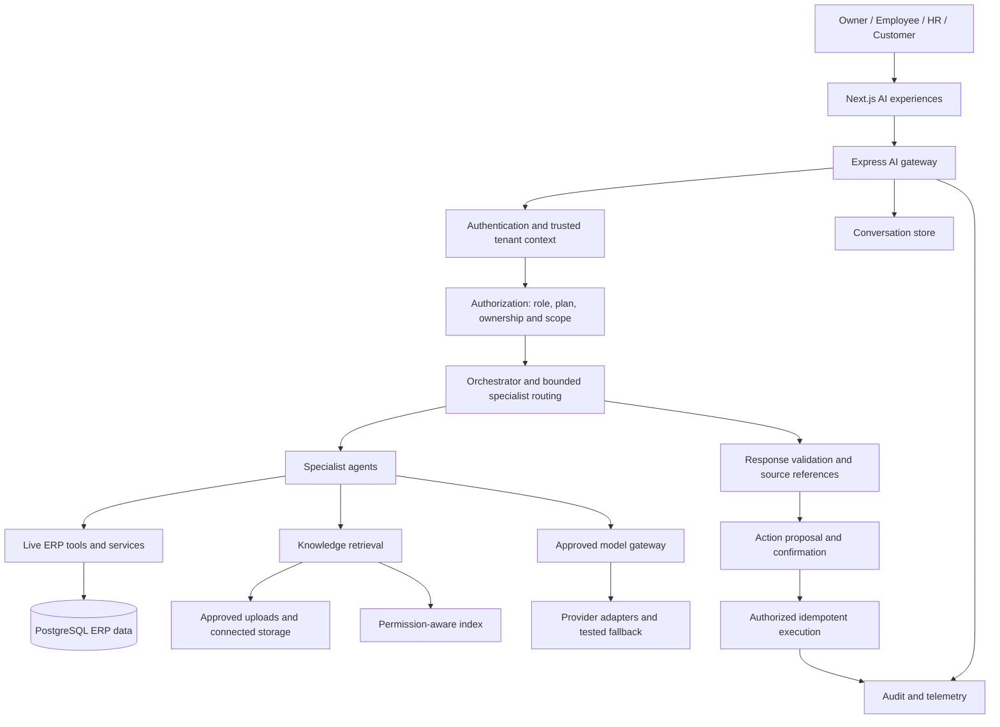

# SmartERP AI — Architecture Decision Record & Implementation Roadmap

**Document version:** 1.0
**Status:** Planning baseline supplied by user; approval state and implementation progress are not established by this document
**Date:** 23 October 2026
**Scope:** SmartERP AI platform, specialist agents, provider gateway, live ERP data access, document RAG, conversation persistence, customer assistant, security, migrations and release validation.

---

## 1. Executive decision

SmartERP AI will evolve into a secure, multi-tenant AI platform built around the existing Next.js frontend, Express backend, PostgreSQL-backed ERP services and current AI tooling where practical.

The architecture will use:

- A centralized AI gateway and authorization boundary.
- A bounded orchestrator coordinating logical specialist agents.
- Secure live ERP service/API access for current operational records.
- Permission-aware RAG for approved uploads, connected storage sources and company knowledge.
- Server-side conversation persistence with ownership, retention and deletion controls.
- A provider-neutral model gateway with only pre-approved providers and tested fallback.
- A customer-facing assistant with customer-level isolation and confirmed service-request creation.
- Durable audit records, measurable operational behavior and staged release gates.

### Architecture principles

1. The server is authoritative for identity, company, role, plan and record permissions.
2. Live ERP data remains the source of truth for operational state.
3. Documents are evidence, not authorization instructions.
4. The model may propose actions but cannot authorize itself to execute them.
5. All provider integrations are explicitly approved and capability-tested.
6. Existing functionality must remain covered during migration.
7. No production migration or deployment occurs without environment verification, backup/recovery planning and release approval.

## 2. Architecture decision record

### ADR-001 — Hybrid live data and document retrieval

**Decision:** Use live ERP tools for current records and RAG for approved documents.

Live data examples: jobs, attendance, inventory, invoices, payroll summaries, customers and machine service records.

Document examples: company policies, approved HR handbooks, operating procedures, manuals and connected company knowledge sources.

**Rationale:** Operational records can change at any time. Document retrieval provides relevant background and policy evidence, while live tools supply current state.

**Consequences:** The platform needs two retrieval paths, separate authorization checks, source attribution and evaluation of both live-data correctness and document retrieval quality.

### ADR-002 — Logical specialist agents sharing a common platform

**Decision:** Implement specialists for general assistance, jobs and operations, HR, attendance, inventory, CNC, finance, payroll, GST, executive analytics, knowledge retrieval and customer assistance.

Specialists will share the orchestration infrastructure, registered tools and approved provider adapters. Different models may be selected only where evaluation demonstrates a meaningful benefit.

**Rationale:** This extends the existing specialist-scope design without requiring a premature distributed-agent architecture.

**Consequences:** Each specialist needs an explicit tool allowlist, input/output schema, entitlement policy, execution budget and evaluation suite. Parallel execution must be bounded.

### ADR-003 — Configurable multi-provider gateway

**Decision:** Introduce a provider-neutral interface with explicit configuration of approved provider/model combinations.

Fallback may occur only to pre-approved, capability-compatible alternatives whose privacy and cost requirements have been reviewed.

**Rationale:** Reduces dependence on one provider without allowing uncontrolled changes in cost, data handling or model behavior.

**Consequences:** Each adapter needs conformance tests, timeout/error mapping, usage telemetry, capability declarations and documented fallback behavior. Provider credentials remain server-side.

### ADR-004 — Permission-aware RAG across uploads and connected storage

**Decision:** The first RAG release will support approved uploads and approved connected storage sources.

The ingestion pipeline will capture source, tenant, audience, classification, permissions, version, status and freshness metadata. Retrieval will enforce permissions before passages are passed to the model.

**Rationale:** Company knowledge should be searchable without bypassing existing document permissions.

**Consequences:** The project must choose and approve supported connectors, file types, parsing behavior, indexing technology, deletion propagation and source attribution. Connector-specific capabilities must be verified rather than assumed.

### ADR-005 — Server-side conversation persistence

**Decision:** Persist conversations and messages on the server with explicit user, company and, where applicable, customer ownership.

Implement retention, deletion, authorization, audit and privacy controls before enabling broad rollout.

**Rationale:** Enables controlled cross-device continuity and a consistent policy for retention and access.

**Consequences:** Browser history becomes a client cache rather than the source of truth. Data migration from local history is optional and must not happen silently. Sensitive data must not be included in logs unnecessarily.

### ADR-006 — Customer assistant with confirmed service requests

**Decision:** Introduce a customer-facing chat experience after the internal pilot. It may answer authorized questions about the authenticated customer's own records and approved knowledge. It may propose creation of service requests, but a request must be validated and explicitly confirmed before execution.

**Rationale:** Provides customer self-service without exposing internal ERP data or allowing uncontrolled mutations.

**Consequences:** Customer identity must be derived from trusted server-side authentication and mapped to the correct company/customer records. Every tool must enforce customer-level ownership independently of model output.

### ADR-007 — One canonical action lifecycle

**Decision:** Standardize action proposals, confirmation, execution, idempotency and audit. Existing action paths must be reviewed and migrated to this policy or explicitly retired.

**Rationale:** The discovery identifies differences between the primary confirmation route and a legacy business-copilot workflow.

**Consequences:** Authorization is rechecked at execution time. Duplicate submissions must not create duplicate jobs or service requests. The UI must report actual execution results rather than assume success.

### ADR-008 — Centralized authorization and audit

**Decision:** Enforce identity, tenant, role, subscription and specialist-scope policies across fast paths, specialist agents, retrieval, tools and action execution.

Resolve the discovered audit-schema mismatch through reviewed migrations, not request-time schema mutation.

**Rationale:** The discovery identifies a fast-path entitlement gap, inconsistent tool role policies and uncertain audit persistence.

**Consequences:** A canonical permission matrix and explicit database/RLS verification are release prerequisites.

---

## 3. Target logical architecture

### Core component contracts

| Component | Responsibility | Must not do |
|---|---|---|
| AI gateway | Authenticate, validate, establish trusted context, apply policy and rate limits | Trust client-supplied identity as authoritative |
| Orchestrator | Select specialists, manage budgets and aggregate results | Grant permissions to itself or a specialist |
| Specialist agent | Perform a bounded domain task using approved tools | Access tools outside its authorization policy |
| Live-data tools | Retrieve current records using existing authorized services | Substitute stale document content for current records |
| RAG service | Search permitted documents and return source-backed passages | Treat retrieved instructions as trusted system policy |
| Provider gateway | Select approved models, enforce budgets and handle eligible failures | Switch to unapproved providers or silently ignore privacy restrictions |
| Action executor | Reauthorize, validate, deduplicate and execute approved actions | Execute solely because a model or client requested it |
| Conversation store | Persist authorized conversation history and lifecycle metadata | Allow cross-user or cross-tenant access |
| Audit/telemetry | Record decisions, actions, outcomes and operational health | Store secrets or unnecessary sensitive content |

---

## 4. Phased implementation tickets

Effort estimates are provisional engineering estimates, not delivery commitments. Parallel work is possible only after dependencies are satisfied.

### Phase 0 — Repository baseline, authorization and release blockers

**Goal:** Establish a safe baseline before adding architecture.

| ID | Ticket | Dependencies | Completion criteria |
|---|---|---|---|
| AI-001 | Inventory all active AI routes, UI mounts, legacy paths, tool handlers and environment settings | None | Route and caller map reviewed; no assumption that unmounted components are active |
| AI-002 | Approve the role, plan, tenant and specialist permission matrix | AI-001 | Owner-approved matrix covers all portals, fast paths and tools |
| AI-003 | Correct fast-path entitlement enforcement | AI-002 | Direct API requests cannot bypass plan/scope restrictions |
| AI-004 | Reconcile role rules for finance, GST, payroll and company-wide aggregates | AI-002 | Each data category has explicit allowed roles and record-level limits |
| AI-005 | Review legacy job-creation and action routes | AI-001, AI-002 | Canonical route selected; authorization and duplicate-execution behavior documented |
| AI-006 | Reconcile audit schema and runtime expectations | AI-001 | Migration plan reviewed; audit writes and failures have defined behavior |
| AI-007 | Establish baseline tests, request correlation and sanitized operational logging | AI-001 | Repeatable test report and request-level diagnostic path available |

**Exit gate:** No known authorization bypass remains in the reviewed AI paths; target environment and migration state are identified; baseline tests are repeatable.

### Phase 1 — Canonical gateway, security and audit

**Goal:** Make all AI requests pass through consistent controls.

| ID | Ticket | Dependencies | Completion criteria |
|---|---|---|---|
| AI-101 | Define canonical request, response, source, error and action contracts | AI-001 | Contracts documented and covered by schema tests |
| AI-102 | Centralize trusted tenant and identity context | AI-002, AI-101 | Client identity overrides are rejected or ignored |
| AI-103 | Apply authorization before fast paths, routing and tool execution | AI-003, AI-004, AI-102 | Authorization matrix passes direct-endpoint tests |
| AI-104 | Standardize action proposal, confirmation and execution | AI-005, AI-101, AI-103 | All retained mutation paths use the approved lifecycle |
| AI-105 | Implement idempotency and recovery behavior for actions | AI-104 | Replays cannot duplicate supported mutations |
| AI-106 | Apply reviewed audit-schema migration and validate persistence | AI-006 | Audit writes, query permissions and failure behavior verified |
| AI-107 | Verify database grants, RLS and tenant policies | AI-102, AI-106 | Effective database controls tested in approved staging |

**Exit gate:** The UI, direct API, fast paths and confirmed actions enforce the same applicable authorization policy.

### Phase 2 — Specialist orchestration and provider gateway

**Goal:** Standardize specialist execution and provider operations.

| ID | Ticket | Dependencies | Completion criteria |
|---|---|---|---|
| AI-201 | Define specialist manifests, tool allowlists and output schemas | AI-101, AI-103 | Each specialist has a documented capability and permission boundary |
| AI-202 | Implement bounded supervisor/orchestrator behavior | AI-201 | Routing, fan-out limits, partial results and conflict handling tested |
| AI-203 | Define provider interface and adapter conformance suite | AI-101 | Adapters return standardized outputs, errors and usage metadata |
| AI-204 | Approve provider/model compatibility and privacy matrix | AI-203 | Only explicitly approved configurations are eligible |
| AI-205 | Implement configured primary/fallback selection | AI-204 | Fallback tests cover timeout, transient failure and non-retryable errors |
| AI-206 | Add budgets, concurrency controls and usage telemetry | AI-202, AI-203 | Limits enforced and usage recorded where supported |
| AI-207 | Evaluate deterministic fast paths against equivalent specialist responses | AI-201 | Correctness, latency and unnecessary-model-call tests pass |

**Exit gate:** Specialist execution is bounded, fallback is deterministic and approved, and provider failures cannot become fabricated successful answers.

### Phase 3 — Server-side conversations and document RAG

**Goal:** Deliver permission-aware persistent chat and searchable company knowledge.

| ID | Ticket | Dependencies | Completion criteria |
|---|---|---|---|
| AI-301 | Define conversation schema, ownership, retention and deletion rules | AI-101, AI-102 | Data lifecycle and authorization model approved |
| AI-302 | Implement server-side conversation APIs and storage | AI-301, AI-107 | User/company/customer ownership enforced |
| AI-303 | Update frontend history to use server persistence | AI-302 | Refresh and cross-device behavior verified; local cache cannot bypass policy |
| AI-304 | Approve document sources and connector permissions | AI-102 | Supported upload and connected-storage sources documented |
| AI-305 | Implement document ingestion, parsing, versioning and deletion lifecycle | AI-304 | Document state and source metadata persist correctly |
| AI-306 | Implement permission-aware retrieval and indexing | AI-305, AI-107 | Tenant, audience and ACL filters enforced before model context |
| AI-307 | Add citations, freshness handling and no-evidence behavior | AI-306, AI-203 | Answers identify sources and do not invent unsupported policies |
| AI-308 | Create RAG quality and adversarial evaluation suite | AI-306, AI-307 | Retrieval relevance, access denial and injection tests pass |

**Exit gate:** Conversation isolation and lifecycle controls work; document retrieval respects source permissions, revocation and version state.

### Phase 4 — Customer assistant and service requests

**Goal:** Introduce a secure customer self-service experience.

| ID | Ticket | Dependencies | Completion criteria |
|---|---|---|---|
| AI-401 | Define customer identity, company linkage and customer-record policy | AI-002, AI-102 | Customer-to-company and customer-to-record rules approved |
| AI-402 | Define customer-specific tools and remove internal-only capabilities | AI-201, AI-401 | Tool inventory contains only explicitly approved customer capabilities |
| AI-403 | Build customer assistant UI and authenticated API integration | AI-101, AI-302, AI-401 | Customer UI is intentionally mounted and handles errors correctly |
| AI-404 | Implement validated service-request proposal and confirmation | AI-104, AI-105, AI-402 | Request is created only after authorization, validation and confirmation |
| AI-405 | Add customer isolation and mutation integration tests | AI-403, AI-404, AI-107 | Cross-customer access and replay tests pass |
| AI-406 | Define customer conversation retention and privacy UX | AI-301, AI-403 | Customer-facing data policy and lifecycle behavior verified |

**Exit gate:** Customer access is limited to approved records and documents; service-request creation is confirmed, idempotent and auditable.

### Phase 5 — Internal pilot, release hardening and customer readiness

**Goal:** Prove reliability before customer exposure.

| ID | Ticket | Dependencies | Completion criteria |
|---|---|---|---|
| AI-501 | Run complete authorization and cross-tenant test suite | AI-103, AI-107, AI-308 | No critical or high-severity isolation failures |
| AI-502 | Run provider failure, load and budget tests | AI-205, AI-206 | Measured performance meets approved service targets |
| AI-503 | Run browser end-to-end and ERP regression tests | AI-303, AI-403 | Existing workflows and portal layouts remain functional |
| AI-504 | Verify migrations, backups and rollback/recovery | All schema tickets | Recovery procedure rehearsed successfully |
| AI-505 | Launch limited internal pilot | AI-501–AI-504 | Owner/HR/Employee pilot meets agreed quality and safety criteria |
| AI-506 | Triage pilot issues and re-run regression tests | AI-505 | No unresolved release-blocking defects |
| AI-507 | Conduct customer-pilot security review and authorization sign-off | AI-405, AI-406, AI-506 | Customer-specific sign-off completed |
| AI-508 | Release customer pilot behind controlled feature flags | AI-507 | Rollout and rollback controls verified |

**Exit gate:** Internal pilot approval comes before customer pilot approval. A customer-facing release is not authorized merely because builds or unit tests pass.

---

## 5. Dependency order

The implementation order is deliberate:

1. **Security baseline:** AI-001 through AI-007.
2. **Authorization and action foundation:** AI-101 through AI-107.
3. **Provider and specialist architecture:** AI-201 through AI-207.
4. **Conversation and RAG capabilities:** AI-301 through AI-308.
5. **Customer-facing experience:** AI-401 through AI-406.
6. **Pilot and release verification:** AI-501 through AI-508.

Some design work can run concurrently after contracts are approved. Production changes must remain gated by the actual environment and migration state.

---

## 6. Migration checklist

### Before any migration

- [ ] Confirm the correct repository branches, worktrees and reviewed source revision.
- [ ] Confirm the intended database project/environment and current migration history.
- [ ] Compare current schema with migration files; do not infer live schema from source alone.
- [ ] Obtain a backup or verified recovery mechanism appropriate to the environment.
- [ ] Identify existing duplicate records and incompatible columns before adding constraints.
- [ ] Review grants, roles, RLS policies and application-level tenant predicates.
- [ ] Prepare a disposable/staging test plan and rollback or forward-recovery plan.

### Schema and data changes

- [ ] Reconcile AI audit schema and runtime writes.
- [ ] Add required action idempotency structures only after reviewing existing records and transaction semantics.
- [ ] Add conversation/message ownership and lifecycle fields.
- [ ] Add document registry, ACL, version and ingestion-state structures.
- [ ] Select and provision the approved search/index technology only after design review.
- [ ] Add provider usage and request telemetry structures if persistence is required.
- [ ] Define indexes and query performance checks for tenant-scoped access.
- [ ] Review retention and deletion propagation across conversations, source files, indexes, caches and audit records.

### Rollout and verification

- [ ] Apply migrations in the approved sequence.
- [ ] Verify schema version and migration history.
- [ ] Test representative reads and writes for two distinct tenants.
- [ ] Verify RLS/grants using effective application roles, not only a privileged administrator.
- [ ] Verify conversation and document deletion behavior.
- [ ] Verify audit persistence and operational alerts.
- [ ] Run the application against the migrated schema before enabling new features.
- [ ] Enable features progressively; retain rollback controls.
- [ ] Remove legacy paths only after caller verification and regression tests.

**Do not use request-time DDL to reconcile production schema.** Database schema changes belong in reviewed, versioned migrations.

---

## 7. Acceptance test checklist

All tests below are release requirements. Passing results must be recorded with environment, revision and test evidence.

### A. Identity and authorization

- [ ] Unauthenticated AI requests are rejected.
- [ ] Client-supplied company, user and customer identifiers cannot override trusted identity.
- [ ] Employee personal and assigned-record restrictions are enforced.
- [ ] Company-wide aggregate visibility matches the approved role policy.
- [ ] Subscription scope restrictions apply to direct APIs and deterministic fast paths.
- [ ] Unauthorized tools are denied even when directly invoked.
- [ ] Permissions are rechecked at action execution time.
- [ ] Super Admin platform operations remain isolated from company-level permissions.
- [ ] Database RLS and application tenant checks work together.
- [ ] Missing tenant context or required authorization fails closed.

### B. Live ERP data

- [ ] Current job, attendance, inventory and other supported operational answers reflect the authorized live source.
- [ ] Unauthorized records are excluded before reaching the model.
- [ ] Data-query failures are not represented as successful zero-value results.
- [ ] Sensitive fields are minimized in model context and responses.
- [ ] Live data changes are reflected without relying on stale document content.

### C. Specialist orchestration

- [ ] Each specialist uses only its declared tools.
- [ ] Unsupported or malformed tool arguments are rejected.
- [ ] Multiple specialists obey concurrency and call budgets.
- [ ] Conflicting or partial specialist results are handled explicitly.
- [ ] Routing and deterministic fast paths have regression tests.
- [ ] Specialist responses do not grant themselves additional permissions.

### D. Provider gateway

- [ ] Every enabled provider passes the adapter conformance suite.
- [ ] Only approved provider/model combinations can be selected.
- [ ] Fallback works for eligible transient errors and timeouts.
- [ ] Authentication, authorization and invalid-request failures do not trigger blind retries.
- [ ] Quota exhaustion follows the approved cost and privacy policy.
- [ ] Total retries, tokens, latency and concurrency remain within limits.
- [ ] Complete provider failure produces an honest, safe unavailable response.
- [ ] Provider credentials never reach client code, browser storage or response payloads.

### E. Document RAG and connected storage

- [ ] Approved uploads can be ingested and retrieved.
- [ ] Each supported connected source has verified authentication and permission semantics.
- [ ] Cross-tenant documents are excluded.
- [ ] Audience-restricted and revoked documents are excluded before prompt construction.
- [ ] Document updates, versioning and deletion propagate to retrieval.
- [ ] Answers cite valid, authorized source passages.
- [ ] Missing evidence leads to an appropriate uncertainty response.
- [ ] Malicious document instructions cannot override authorization or system policy.
- [ ] Retrieval relevance and citation correctness meet approved evaluation thresholds.
- [ ] Current operational questions use live ERP tools rather than stale RAG content.

### F. Server-side conversation persistence

- [ ] Authorized users can resume conversations according to the retention policy.
- [ ] A user cannot access another user's private conversation.
- [ ] Company and customer conversation boundaries are enforced.
- [ ] Retention expiry and deletion work as specified.
- [ ] Deleted conversation content is not inadvertently restored from a client cache.
- [ ] Browser history is not treated as trusted identity or authorization.
- [ ] Sensitive prompt content is excluded from routine telemetry unless explicitly justified and approved.

### G. Customer assistant and service requests

- [ ] Customer UI is available only on intended customer routes.
- [ ] Customer identity is derived from trusted authentication.
- [ ] A customer cannot retrieve another customer's jobs, service requests or documents.
- [ ] Customer tools cannot expose employee, payroll, internal finance or administrative data.
- [ ] Service requests are proposed before execution.
- [ ] Invalid request fields and unauthorized target records are rejected.
- [ ] Explicit confirmation is required where the action policy specifies it.
- [ ] Duplicate confirmation/retries do not create duplicate service requests.
- [ ] The response reports the actual persisted request result.
- [ ] Customer conversations and requests follow the approved retention and audit policy.

### H. Actions, audit and recovery

- [ ] Every supported mutation follows the canonical action lifecycle.
- [ ] Action replay and duplicate submissions are idempotent.
- [ ] Partial failures have a documented recovery or reconciliation outcome.
- [ ] Audit records contain required actor, tenant, action, outcome and request correlation fields.
- [ ] Audit queries enforce appropriate tenant and platform-admin access.
- [ ] Required audit failure behavior is tested and operationally visible.
- [ ] Database migrations and rollback/recovery have been rehearsed.
- [ ] Legacy routes cannot bypass the canonical authorization policy.

### I. Portal regression and operations

- [ ] Owner, Employee and HR portal behavior remains correct.
- [ ] Customer assistant behavior matches the approved customer policy.
- [ ] Super Admin operations remain separate and authorized.
- [ ] Existing widgets, navigation, confirmations and error states remain functional.
- [ ] Mobile and desktop layouts pass regression tests.
- [ ] Provider outage, empty retrieval and permission denial are handled correctly.
- [ ] Latency, cost, token usage, failure rates and retrieval quality are measured.
- [ ] Feature flags, alerts and rollback controls are verified.

---

## 8. Release gates and sign-off

| Gate | Required evidence | Decision |
|---|---|---|
| Gate 0 — Baseline | Source inventory, permission matrix, schema/environment verification, baseline test report | May begin implementation |
| Gate 1 — Security foundation | Fast-path, role, tenant, action and audit tests; approved migration review | May proceed to broader AI platform work |
| Gate 2 — Platform | Specialist and provider conformance tests, budget enforcement and safe failure behavior | May proceed to RAG integration |
| Gate 3 — Data lifecycle | Conversation isolation/retention/deletion tests; RAG ACL, citation and revocation tests | May proceed to customer-specific implementation |
| Gate 4 — Customer readiness | Customer isolation, confirmed request creation, idempotency and audit tests | May enter internal release validation |
| Gate 5 — Internal pilot | End-to-end regression, performance baseline, operational monitoring and recovery rehearsal | Internal pilot may proceed |
| Gate 6 — Customer pilot | Internal pilot sign-off, resolved critical/high issues, customer security approval and rollback readiness | Customer pilot may proceed |

### Automatic release blockers

- Any confirmed cross-tenant or cross-customer data exposure.
- Any unauthorized business mutation.
- A plan or role restriction bypass through a direct endpoint or fast path.
- Unapproved provider use or credentials exposed to the client.
- Inability to enforce document ACLs before model context construction.
- Duplicate mutations caused by retries.
- Missing required audit evidence with no approved fail-safe behavior.
- Unverified production migration state or unavailable recovery path.

### Sign-off roles

- **Product/business owner:** approves portal capabilities, specialist entitlements and customer service-request behavior.
- **Backend/data owner:** approves schema changes, service contracts and data integrity.
- **Security reviewer:** approves tenant isolation, RLS/grants, customer boundaries, RAG permissions and action controls.
- **QA/release owner:** signs off test evidence, regression results, monitoring and rollback.
- **Deployment owner:** confirms the reviewed revision and approved environment before rollout.

---

## 9. Operational measures to establish before pilot

Numerical service-level targets must be set after staging measurements rather than invented now.

Track at minimum:

- End-to-end p50, p95 and p99 latency by workflow.
- Provider success, timeout, fallback and exhausted-budget rates.
- Token usage and estimated cost per workflow and provider.
- Tool-call success and failure rates.
- RAG retrieval relevance and citation correctness.
- Cross-tenant authorization denials and security events.
- Audit persistence failures.
- Duplicate-action prevention and reconciliation counts.
- Conversation deletion and document-revocation propagation time.
- Feature-flag rollback and service recovery time.

Alert thresholds, retention periods, latency budgets, cost ceilings and retrieval-quality targets require explicit owner approval.

---

## 10. Open decisions to resolve during Phase 0

These are not silently assumed by this ADR:

1. Exact approved document connectors and their authentication/ACL capabilities.
2. Search/index technology and hosting model.
3. Approved model providers, model versions and fallback ordering.
4. Conversation retention duration, deletion semantics and audit retention exceptions.
5. Whether and how legacy browser history should be migrated.
6. Exact customer service-request fields, confirmation UX and notification workflow.
7. Numeric performance, cost and retrieval-quality targets.
8. Effective production database RLS, grants, migration history and deployed source revision.

Each decision must have an owner, evidence and acceptance criteria before the dependent ticket can be considered complete.

---

## 11. Final implementation instruction

**Do not implement the entire architecture as one unrestricted rewrite.**

Proceed in dependency order, starting with repository and environment discovery, authorization and audit remediation. Preserve existing API compatibility where practical. Introduce new components behind feature flags, test each boundary independently, and remove legacy paths only after their callers and behavior have been verified.

The current-state discovery is a source audit, not proof of deployed runtime behavior. Production readiness must be established by approved staging tests, database verification, end-to-end evidence and formal release sign-off.

**Final status:** Architecture and implementation plan finalized for planning. No code, database or deployment changes have been made by this document.
---

## 12. Current source baseline and portal alignment

This addendum cross-references the roadmap against the source discovery in SMARTERP_AI_CURRENT_STATE.md and SMARTERP_AI_DISCOVERY_SUMMARY.md (inspection date: 23 October 2026). These are source audits of the checked-out repositories. They do not prove deployed behavior, database policy, or production readiness.

| Portal / area | What source discovery found | Roadmap implication |
|---|---|---|
| Owner | Uses the shared FloatingActionHub → SmartAIPanel when authentication and frontend plan context enable the assistant. Backend company-scoped data tools cover supported business summaries. | Keep owner access behind the canonical role, tenant, plan, scope, and tool checks. Test direct API access as well as the UI. |
| Employee | Uses the shared assistant under the same frontend availability gate. Some tools filter to assigned jobs; some company-wide aggregates include Employee. | Product/security owner must explicitly decide whether each aggregate is appropriate for employees; employee role must not imply unrestricted record access. |
| HR | Uses the shared assistant under the same frontend availability gate. HR data tools and specialist permissions exist in source. | Define HR-specific data categories and record-level permissions in the approved matrix; verify them at each tool boundary. |
| Customer | No visible customer chat mount was found in the inspected frontend; the shared panel hides itself on /customer*. A customer-summary plugin exists in backend source. | Customer assistant remains future work. The plugin alone is not a customer-facing feature or proof of customer-level isolation. |
| Super Admin | Has separate AI Operations statistics/audit UI and security-investigation paths. These are distinct from the company assistant and have separate authorization surfaces. | Keep platform operations separate from company tenant permissions. Test Super Admin capabilities independently and do not grant implicit company-data access. |

### Source-backed implementation status at discovery time

- A shared authenticated AI gateway, deterministic summaries, specialist-scope routing, a bounded ReAct tool loop, and a Groq provider adapter exist in source.
- The current multi-agent option fans out scope-specific runs over shared orchestration/provider code; independent autonomous agents or multiple provider adapters are not established.
- A customer-facing assistant, permission-aware document ingestion/RAG pipeline, and server-side conversation persistence were not found as active completed paths in the discovery.
- Discovered source risks include fast-path plan enforcement inconsistency, unresolved employee aggregate visibility policy, legacy business-copilot action behavior, and AI audit schema/runtime DDL mismatch.
- Focused mocked/source tests passed in the prior discovery run, but browser, live PostgreSQL/RLS, provider, staging, and production verification remain outstanding. Refer to the discovery report for exact commands and outcomes.

### Planning status

This roadmap is a planning artifact. Its tickets and gates are not evidence of implementation. Track each ticket with a source revision, environment, test evidence, and owner sign-off. No database migration, production change, deployment, or release approval is implied by adding this document.
