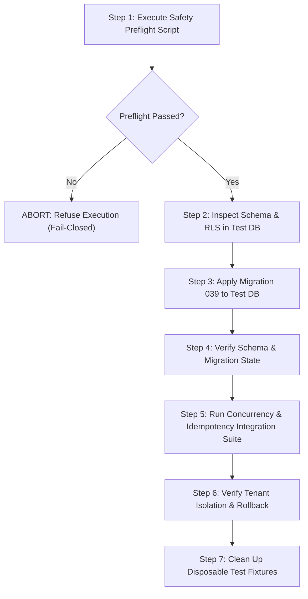

# SmartERP Phase 8 — Payment Idempotency Database Integration Plan

> [!IMPORTANT]
> **Pre-Flight Safety Boundary:** This plan is prepared for future execution only. No live database queries, migrations, or provider transactions are executed in Phase 7. The production Supabase database must never be used for integration testing.

---

## 1. Project Owner Setup Instructions for Dedicated Supabase Test Project

The project owner must provision a brand-new, completely separate Supabase project. A separate database schema or table inside the existing production project is **strictly forbidden** as it shares connection pools, superuser roles, and database-level RLS settings.

### Step 1.1: Create New Supabase Project
1. Log in to the [Supabase Dashboard](https://supabase.com/dashboard).
2. Click **New Project** and select your organization.
3. Name the project `smarterp-isolated-test` (or similar clear test identifier).
4. Generate and securely store a dedicated strong database password.
5. Select the appropriate region (matching application hosting, e.g., `AWS ap-northeast-1`).
6. Wait for project provisioning to complete.
7. Record the **Project Ref** (e.g., `xyzprojectref123456`).

### Step 1.2: Create Least-Privileged Test Role
Do **not** use the default `postgres` superuser for tenant-isolation and idempotency tests, as superuser accounts automatically bypass Row-Level Security (`rolbypassrls`).

Execute the following SQL in the Supabase SQL Editor of the **test project**:

```sql
-- 1. Create a dedicated application role without superuser or bypassrls privileges
CREATE ROLE smarterp_test_runner WITH LOGIN PASSWORD 'choose_strong_test_password';

-- 2. Grant connection and schema usage
GRANT CONNECT ON DATABASE postgres TO smarterp_test_runner;
GRANT USAGE, CREATE ON SCHEMA public TO smarterp_test_runner;

-- 3. Verify that the role cannot bypass RLS
SELECT rolname, rolsuper, rolbypassrls FROM pg_roles WHERE rolname = 'smarterp_test_runner';
-- Must return: rolsuper = false, rolbypassrls = false
```

### Step 1.3: Provision the Test Database Identity Marker
The preflight safety checker requires an immutable identity marker row before permitting any integration script:

```sql
CREATE TABLE IF NOT EXISTS smarterp_test_database_identity (
  id SERIAL PRIMARY KEY,
  environment VARCHAR(50) NOT NULL,
  project_ref VARCHAR(100) NOT NULL,
  database_name VARCHAR(100) NOT NULL,
  database_role VARCHAR(100) NOT NULL,
  isolation_token VARCHAR(255) NOT NULL,
  approved_by VARCHAR(100) NOT NULL,
  created_at TIMESTAMPTZ DEFAULT NOW()
);

-- Insert the authorized test marker (replace placeholders with actual test project values)
INSERT INTO smarterp_test_database_identity (
  environment,
  project_ref,
  database_name,
  database_role,
  isolation_token,
  approved_by
) VALUES (
  'isolated_test',
  '<your-test-project-ref>',
  'postgres',
  'smarterp_test_runner',
  '<generate-random-token-min-16-chars>',
  'Project Owner'
);

-- Grant permissions on identity table to the test runner
GRANT SELECT ON smarterp_test_database_identity TO smarterp_test_runner;
```

### Step 1.4: Configure `.env.test.local` (Local Only — Git Ignored)
In `SmartERP-BackendEnd/`, create `.env.test.local` (confirmed git-ignored):

```env
NODE_ENV=test
SMARTERP_ENVIRONMENT=isolated_test
DATABASE_URL=<your-production-url-retained-unchanged>
TEST_DATABASE_URL=postgresql://smarterp_test_runner:<test_password>@aws-0-<region>.pooler.supabase.com:5432/postgres
TEST_DATABASE_PROJECT_REF=<your-test-project-ref>
TEST_DATABASE_ROLE=smarterp_test_runner
TEST_DATABASE_ISOLATION_TOKEN=<generated-random-token-min-16-chars>
TEST_DATABASE_AUTHORIZATION=AUTHORIZED_BY_OWNER_FOR_TESTING
```

---

## 2. Phase 8 Execution Workflow

Once the test project is confirmed and `.env.test.local` is populated, Phase 8 proceeds in strict sequential order:



### Step 2.1: Execute Preflight Check
Run the safety preflight utility:
```bash
node scripts/paymentTestDatabasePreflight.js
```
The script will verify:
- `TEST_DATABASE_URL` is separate from `DATABASE_URL`.
- Connected user is `smarterp_test_runner`.
- Role has `rolsuper: false` and `rolbypassrls: false`.
- `smarterp_test_database_identity` matches the configuration token.

### Step 2.2: Inspect Baseline Schema & Policies
Before migration, verify that the baseline tables exist in the test project:
```sql
SELECT table_name FROM information_schema.tables WHERE table_name IN ('invoices', 'invoice_payments', 'companies');
SELECT policyname, tablename, cmd, qual FROM pg_policies WHERE tablename = 'invoice_payments';
```
Ensure `tenant_isolation_invoice_payments` is enabled and active.

### Step 2.3: Controlled Application of Migration 039
Apply migration `039_invoice_payment_idempotency.sql` manually or via a controlled test runner script targeting `TEST_DATABASE_URL`.
Verify:
1. Columns added: `idempotency_key`, `request_fingerprint`, `result_status`, `result_amount_paid`, `result_amount_due`.
2. Index created: `idx_invoice_payments_company_idempotency` on `(company_id, idempotency_key) WHERE idempotency_key IS NOT NULL`.
3. Constraint added: `invoice_payments_idempotency_result_check` marked `NOT VALID`.

### Step 2.4: Integration Test Suite (Separate Connections)
Run a dedicated live integration runner with disposable test data (e.g. `company-test-801` and `company-test-802`):

1. **Legacy Keyless Compatibility:**
   - Execute an unkeyed payment insert.
   - Verify row is written with `idempotency_key IS NULL` and invoice balance updates correctly.
2. **Same Key Replay:**
   - Call payment record with Key `K-001` and fingerprint `F-001`.
   - Call payment record again with Key `K-001` and fingerprint `F-001`.
   - Verify only 1 payment row exists in `invoice_payments`.
   - Verify the second response matches the committed response from the first.
3. **Mismatched Fingerprint Rejection (HTTP 409):**
   - Call payment record with Key `K-001` and a modified amount or payment method.
   - Verify call is rejected with `HTTP 409 Conflict`.
   - Verify invoice totals and payment rows remain unaltered.
4. **PostgreSQL Concurrency Race:**
   - Open two distinct database connections (Client 1 and Client 2).
   - Concurrently execute `recordPayment` with the same key `K-RACE-001` and identical intent.
   - Verify connection 1 inserts successfully; connection 2 hits `23505 (unique_violation)`, rolls back to savepoint `payment_idempotency_insert`, re-reads the committed row, and returns the identical outcome.
   - Verify exactly 1 payment record exists in `invoice_payments` and invoice `amount_paid` is incremented exactly once.
5. **Cross-Company Isolation:**
   - Company A records payment with Key `K-CROSS-01`.
   - Company B records payment with Key `K-CROSS-01` against Company B's invoice.
   - Verify both payments succeed independently under their respective companies without cross-tenant conflict.
6. **Transaction Rollback:**
   - Induce an error during invoice update (e.g., negative balance check or trigger).
   - Verify transaction rollback removes the payment row and reverts invoice balances.

### Step 2.5: Safe Cleanup
Clean up only test rows explicitly created with company IDs prefixed with `company-test-` or specific fixture UUIDs:
```sql
DELETE FROM invoice_payments WHERE company_id = 999999;
DELETE FROM invoices WHERE company_id = 999999;
```
Never execute broad `TRUNCATE` or unconstrained `DELETE` statements.
